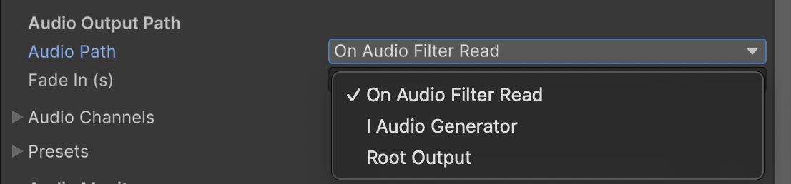

## Audio Output Path ##

> **New in v4.0.0** — `OnAudioFilterRead` works everywhere; `IAudioGenerator` and `RootOutput`
> require Unity 6.

Csound's audio has to reach Unity somehow, and v4 offers three routes to do it. **The default is
`OnAudioFilterRead` on every Unity version, and most projects never need to change it.**

The path is chosen per component, in the **Audio Output Path** section of the inspector below Audio
Input Routes, and cannot be changed while the scene is running.

> **Not WebGL.** All three paths go through Unity's audio engine, and Unity does not call
> `OnAudioFilterRead` on WebGL at all. There Csound sends its output to the browser directly, and
> spatialization is done by passing the listener's azimuth, elevation and distance into the
> orchestra — see [WebGL support](webgl_support.md#spatialization).

---

### The three paths ###

| | OnAudioFilterRead | IAudioGenerator | RootOutput |
|---|---|---|---|
| Unity version | all | 6+ | 6+ |
| Default | **yes** | no | no |
| AudioSource | required | required | not used |
| AudioMixer — effects, routing, snapshots | yes | yes | bypassed |
| 3D spatialization | yes | yes | no |
| `processClipAudio` | yes | falls back to OnAudioFilterRead | falls back to OnAudioFilterRead |
| Latency | the reference | one DSP block later | same as OnAudioFilterRead |

---

### Which one to pick ###

**OnAudioFilterRead** is the one to keep unless something pushes you off it. It is the only path
below Unity 6, the only one that supports `processClipAudio`, and it performs Csound inside the
callback for the block being produced, so its audio leaves in that same block.

> Clip audio is read in `OnAudioFilterRead` and nowhere else, so neither of the other two paths
> can carry it. Rather than letting the clip play untouched past Csound, which with a microphone
> capture means feedback, an instance with `processClipAudio` enabled **switches itself back to
> OnAudioFilterRead at startup** and says so in the console. Turn `processClipAudio` off to keep
> the path you chose.

**IAudioGenerator** is what Unity 6 intends for generated audio: the generator *is* the source, so
the silent carrier clip `OnAudioFilterRead` needs — and the multiplication of Csound's output by it —
are not involved at all. It costs one DSP block, with no jitter whatsoever. Pick it when that
steadiness is worth a block, and when you still want the mixer.
See [IAudioGenerator](iaudiogenerator.md).

**RootOutput** writes straight into Unity's main mix: nothing between Csound and the hardware. The
AudioSource comes with the component either way, since the path is an inspector choice, but this one
does not read it, so its volume, mute and 3D settings do nothing. Pick it for what it removes — mixer CPU, and any chance of an effect adding
latency — rather than for speed: on an empty mixer it lands on the same sample as
`OnAudioFilterRead`. See [RootOutput](root_output.md).

---

### Measured latency ###

The figure to remember is **one block**, not a number of milliseconds: in milliseconds it becomes
whatever DSP buffer the project uses.

| Path | Latency |
|---|---|
| `OnAudioFilterRead` | delivers within the current DSP block — the reference |
| `RootOutput` | same, sample-aligned |
| `IAudioGenerator` | one DSP block later |

Measured over twenty triggers per configuration, timing from the moment a control channel is set to
the sample where the resulting click appears:

| Buffer | Difference, IAudioGenerator vs OnAudioFilterRead |
|---|---|
| 1024 frames @ 48 kHz | 20.53 ms |
| 256 frames @ 44.1 kHz | 5.80 ms |

At 256 frames all twenty clicks landed at 5.80 ms — `256/44100` to the hundredth, with no spread.
`RootOutput` writes past the point a recording inside Unity can tap, so it was measured differently:
two instances fired at the same instant, clicks at different amplitudes, recorded from outside Unity.
Nineteen of twenty triggers landed on the same sample as `OnAudioFilterRead`.

#### Why bypassing the mixer buys nothing ####

In a block-based engine only stages that **buffer** add latency — stages that read block N and emit
it in block N+1. The AudioMixer is not one of those: it is a graph evaluated inside the same
callback, so sources, effects and master all resolve within the same block. Bypassing it saves CPU,
not time. `IAudioGenerator`'s extra block fits the same rule from the other side: it genuinely is a
buffering stage.

Where `RootOutput` does win is against effects that have latency of their own. With a single **Pitch
Shifter** on the `OnAudioFilterRead` source's mixer group, pitch left at 1.0 so only its latency is
in play:

| Mixer group on the OnAudioFilterRead source | Gap |
|---|---|
| none | 0 samples, 19 of 20 triggers |
| Pitch Shifter, FFT size 1024 | **1024 samples** (21.33 ms) |
| Pitch Shifter, FFT size 2048 | **2048 samples** (42.67 ms) |

The gap tracks the effect's FFT size, which is what makes it the effect's latency rather than a
coincidence, and it does not move with the DSP buffer. So the mixer costs nothing by itself and costs
exactly what its effects cost; bypassing it saves precisely that, which on an empty chain is zero.

> Measured on macOS with Unity 6000.3.10f1. Other platforms have not been measured, and mobile is
> where these numbers would move.

---

### Channels and speakers ###

`nchnls` decides how many channels Csound produces, and the project's speaker mode decides how many
Unity wants. Csound channel 0 goes to Unity's first output channel, channel 1 to the second, and so
on. The speakers past `nchnls` are silent, and a mono orchestra, being a single signal, plays from
every speaker. So a stereo csd on a 5.1 project comes from the front left and front right, and
`nchnls = 6` fills all six.

An orchestra wider than the output loses the channels Unity has no speaker for: with `nchnls = 6` on
a stereo project only channels 0 and 1 are heard. The [audio monitor](audio_monitor.md) still shows
all six, and [audio routes](audio_input_routing.md) still carry all six to another instance, because
both read Csound's own buffer rather than Unity's output.

#### A spatialized instance is one point source ####

A position in the scene has one signal at it, not a channel per speaker. So on **OnAudioFilterRead**,
as soon as **Spatial Blend** leaves 0, what reaches each speaker is the orchestra's channels summed
together, scaled by the gain Unity's panner computed for that speaker. The channel-per-speaker
mapping above is what a flat instance gets, and between the two ends the output crosses over with the
blend. The blend is read every frame, so animating it works.

Summed, rather than averaged, because that is what Unity's own panner does to a multichannel source:
all three paths then place an instance at the same level, and the path is a choice about latency and
the mixer rather than about how the instance sounds. An orchestra that writes full scale on several
channels can therefore overshoot when it is spatialized, exactly as a multichannel AudioClip does.

> The two ends of the blend are exact. Part way along it the level is approximate, and the wider the
> output the further off it can be: the carrier arrives as one number per speaker, and halfway along
> the blend that number no longer says how much of it is the flat mapping and how much is the panner.
> On a stereo output the dip is under 2 dB; on 5.1 a `Spatial Blend` of 0.5 can be well down.
> `IAudioGenerator` has none of this, because there Unity pans the orchestra itself rather than a
> carrier.

On **IAudioGenerator** this is Unity's own doing rather than ours: the generator hands over the
orchestra's channels and Unity's panner places them. A stereo orchestra on a spatialized instance
loses its stereo image there too, like any multichannel AudioClip would. **RootOutput** has no panner
at all, so it is always the channel-per-speaker mapping.

> The carrier clip is where `OnAudioFilterRead` gets this from. It is built as wide as Unity's output
> and reads 1 in every channel, so what arrives in the filter is the gain Unity wants applied. A
> spatializer plugin (Oculus, Steam Audio) replaces Unity's panner, and that pairing has not been
> measured.

---

### Fade In ###

**Fade In (s)** ramps the output up from silence when Csound starts, and all three paths honour it.
0, the default, starts at full level.

It is there for a chained scene. An instance that is fed by
[audio routes](audio_input_routing.md) starts performing before the sources upstream have filled
their buffers, so its first few blocks are built on whatever was in them: a click, or a fragment of
nothing. A fade of a few tens of milliseconds covers that moment. `CsoundUnityChild` has the same
field, for the same reason.

In seconds rather than samples, so it means the same thing whatever the output rate. A change
applies from the next start.

---

### Silencing an instance ###

`mute` and `pauseProcessing` behave identically on all three paths: `mute` silences the output while
Csound keeps performing, `pauseProcessing` silences it and stops the DSP work as well. See
[Audio Input Routing](audio_input_routing.md#silencing-an-instance-which-switch-to-use) for the full
comparison, including how each affects instances routed from this one.

`AudioSource.mute` is a different switch and is **not** path-independent: it silences the
AudioSource, so it does nothing at all on **RootOutput**, which writes to Unity's main output and
does not use one.
