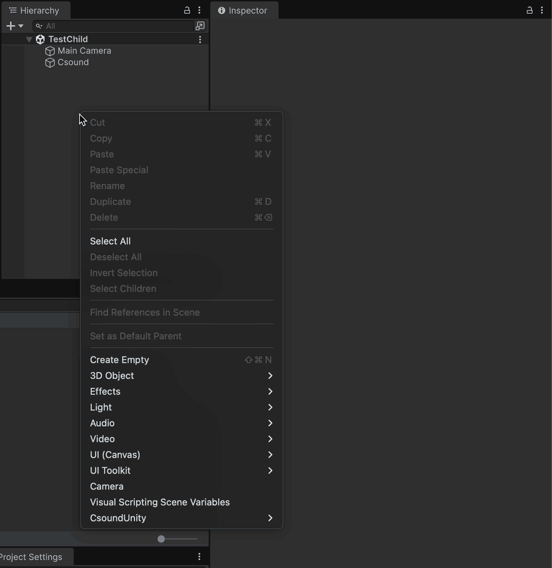

## CsoundUnityChild ##

New in version 3.0, the CsoundUnityChild component lets you read the AudioChannels found in a CsoundUnity instance. You can have as many audio channels you want in your Csd.  
You can set them with the *chnset* opcode.  
See the example below:
```csound
;csd file
<Cabbage>
form caption("Test CsoundUnityChild") 
rslider channel("gain"), range(0, 1, .4, 1, .01), text("Gain")
rslider range(0, 1, 1, 1, 0.001), channel("hrm1")
rslider range(0, 1, 0, 1, 0.001), channel("hrm2")
rslider range(0, 1, 0, 1, 0.001), channel("hrm3")
rslider range(0, 1, 0, 1, 0.001), channel("hrm4")
</Cabbage>
<CsoundSynthesizer>
<CsOptions>
-n -d 
</CsOptions>
<CsInstruments>
; Initialize the global variables. 
ksmps = 32
nchnls = 2
0dbfs = 1

giWave1 ftgen 1, 0, 4096, 10, 1
giWave2 ftgen 1, 0, 4096, 10, 1, .5, .25, .17

;this instrument sends audio to two named channels
;this audio can be picked up by any CsoundUnityChild component..
instr ChildSounds
    a1 oscili 1, 440, giWave1
    chnset a1, "sound1"
    a2 oscili 1, 840, giWave1
    chnset a2, "sound2"
endin

</CsInstruments>
<CsScore>
;causes Csound to run for about 7000 years...
f0 z
i"ChildSounds" 0 z
</CsScore>
</CsoundSynthesizer>
```

To be able to pick those named channels, create a GameObject and add the CsoundUnityChild component. An AudioSource will be added if there is none.  
There you can choose the AudioChannels that this CsoundUnityChild will play and in which configuration.  
If AudioChannelsSetting is set to MONO, the selected AudioChannel is one signal and reaches every output channel, at its own level, the way a mono orchestra does on the parent.  
If AudioChannelsSetting is set to STEREO, the two selected AudioChannels take the first two output channels, and the speakers past them stay silent. On a surround output, give the orchestra the channels you want to reach them.  
Both paths of this component follow that rule and come out at the same level, and when the AudioSource is spatialized the component is placed as one point source: every speaker receives its channels summed, scaled by the gain Unity's panner computed. See [Audio Output Path](audio_output_path.md#channels-and-speakers).



**Be aware that the support for audio channels is still limited**: they're parsed from the csd file, meaning that if you're using variables the CsoundUnityEditor parser won't recognize them.   
The following example will find an audioChannel named "*Sname*", instead of its expected value of "*audioChannel_1*":  

```csound
;csd file
instr 1
kEnv madsr .1, .2, .6, .4
aOut vco2 p5, p4
inumber = 1
Sname sprintf "audioChannel_%02d", inumber
chnset aOut, Sname 
outs aOut*kEnv, aOut*kEnv
endin
```

You can also create the CsoundUnity children with code, for more advanced setups.
You can get the available audio channels from CsoundUnity with:

```csound
//C# code
var audioChannels = csoundUnity.availableAudioChannels;
```

To be able to initialize a child, you should call `CsoundUnityChild.Init(CsoundUnity csound, AudioChannels audioChannels)`, to set the reference to the CsoundUnity instance that has available audio channels, and to define the channel setup to use (MONO or STEREO).
Then you must specify the audio channel you want to use with `SetAudioChannel(int channel, int audioChannel)`: the channel parameter is the LEFT (0) or RIGHT (1) channel, the audioChannel parameter is the index of the *CsoundUnity.availableAudioChannel* you want to use.
See the example that follows:

```csharp
// C# code  
  
[Tooltip("The radius of the circle where the children will be placed, starting from the position of this GameObject")]
[SerializeField] private float _radius = 200f;
[Tooltip("How many meters more the sources will be audible from. This value will be summed to the radius. " +
  "It is to make sure that there will be some sound when the player is equidistant from the sources")]
[SerializeField] private float _rollofTolerance = 100f;
[Tooltip("The CsoundUnity children prefab")]
[SerializeField] private GameObject _childPrefab;

private CsoundUnity _csound;

IEnumerator Start()
{
    _csound = GetComponent<CsoundUnity>();
    while (!_csound.IsInitialized)
        yield return null;

    var n = _csound.availableAudioChannels.Count;

    for (var i = 0; i < n; i++)
    {
        var angle = i * Mathf.PI * 2 / n;
        var pos = new Vector3(Mathf.Cos(angle), 0,  Mathf.Sin(angle)) * _radius;
        var go = Instantiate(_childPrefab, this.transform);

        go.transform.position = pos;
        var child = go.AddComponent<CsoundUnityChild>();
        child.Init(_csound, CsoundUnityChild.AudioChannels.MONO);
        child.SetAudioChannel(0, i);
        child.name = _csound.availableAudioChannels[i];
        var aS = go.GetComponent<AudioSource>();
        aS.rolloffMode = AudioRolloffMode.Custom;
        // when the audio listener is 'radius' meters far from the audio source, there will be no sound, 
        // since the rolloff function will lower the volume accordingly to the custom curve, and at maxDistance the volume will be 0. 
        // Let's add 'rollofTolerance' meters more to have some sound when the listener is equidistant from the created sources
        aS.maxDistance = _radius + _rollofTolerance;
    }
}
```

### Doppler does nothing here

A child reads an audio channel its parent published and writes it into the buffer in the filter
callback, so Unity has no clip to resample and `dopplerLevel` is idle: measured, four children held
330.00 Hz while a plain AudioSource beside them swept from 213 to 446. Everything else Unity does
with position arrives as usual, distance attenuation and panning included.

A shift for a child is made in the parent's orchestra, and once per child, since they each sit
somewhere else: see [Doppler](doppler.md).
