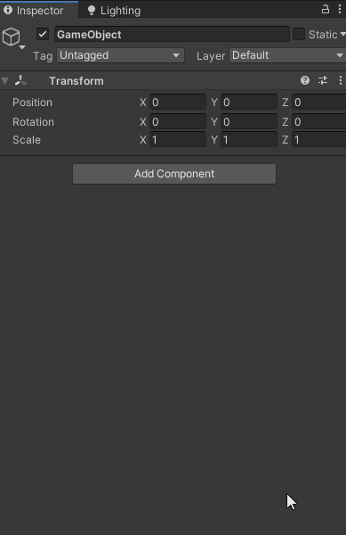
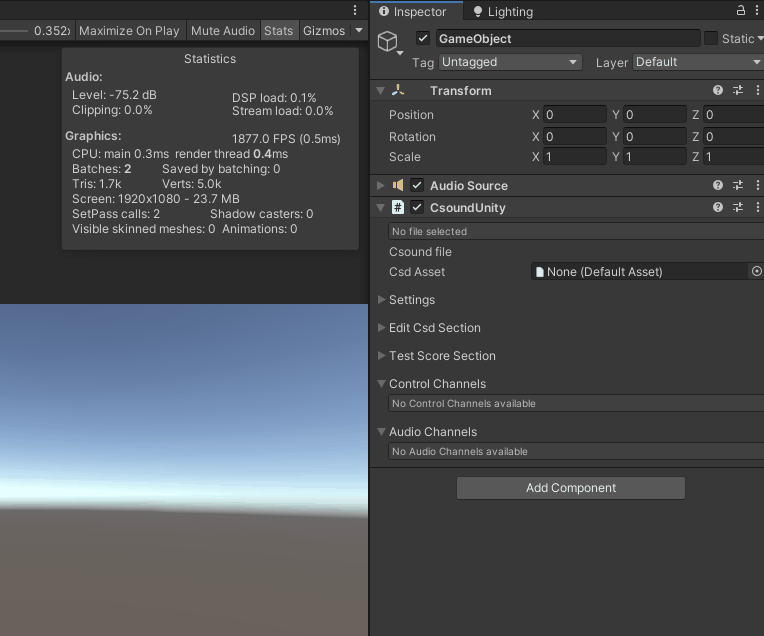

## Getting Started ##

CsoundUnity is a component that can be added to any GameObject in a scene. Press the **Add Component** button in Unity's inspector, search for **CsoundUnity**, and select the **CsoundUnity** component. An **Audio Source** component is added automatically if one does not already exist.



Once the component has been added, drag a `.csd` file from your project assets into the **Csd Asset** field. When Play mode starts, Csound compiles the file and begins sending audio to the Audio Source — integrating seamlessly with Unity's spatial audio, mixer, and effects pipeline.



---

### Namespace ###

All CsoundUnity types live in the `Csound.Unity` namespace. Add the following using directive to any script that references CsoundUnity:

```csharp
using Csound.Unity;
```

---

### Waiting for initialisation ###

**When Csound is ready depends on the platform.** On every platform except WebGL, compilation happens
inside `Awake`, synchronously: by the time any other component's `Start` runs, Csound is up. On WebGL
the WASM bridge loads in the background and `IsInitialized` stays false for a while.

Checking `IsInitialized` before calling channel or score methods covers both, which is why it is the
pattern to use:

```csharp
using Csound.Unity;
using UnityEngine;

public class MyAudioController : MonoBehaviour
{
    private CsoundUnity _csound;

    void Start()
    {
        _csound = GetComponent<CsoundUnity>();
    }

    void Update()
    {
        if (!_csound.IsInitialized) return;
        _csound.SetChannel("gain", 0.5);
    }
}
```

Alternatively, subscribe to the `OnCsoundInitialized` event — see [Lifecycle API](lifecycle.md) for the full set of initialisation patterns.

---

### What's new in v4.0.0 ###

| New | Doc |
|---|---|
| Csound 7 on all platforms | [Supported Platforms](platforms.md) |
| IAudioGenerator audio path (Unity 6+) | [IAudioGenerator](iaudiogenerator.md) |
| RootOutput audio path (Unity 6+) | [RootOutput](root_output.md) |
| Native low-latency audio input (macOS, iOS, Android, Windows) | [Native Audio Input](native_audio_input.md) |
| MIDI input (CoreMIDI, AAudio MIDI, WinMM) | [MIDI Input](midi.md) |
| UI components (Slider, Button, Toggle, XYPad, Keyboard, Meter, …) | [UI Components](ui_components.md) |
| Audio Input Routing and the Route Graph editor | [Audio Input Routing](audio_input_routing.md) |
| Timeline integration (score events, channel automation) | [Timelines](timelines.md) |
| Lifecycle API (Initialize, Stop, Restart) | [Lifecycle API](lifecycle.md) |
| Audio Monitor in the inspector | [Audio Monitor](audio_monitor.md) |

### Everything else the package does ###

These are not new in 4.0 — they are what CsoundUnity has carried for a while, and they still work
the same way.

| | Doc |
|---|---|
| Read and write Csound channels from C#, and send score events | [From Unity scripts](controlling_csound_from_unity.md) |
| Controls in the inspector, built from the csd's `<Cabbage>` widgets, usable while the game runs | [From the Unity Editor](controlling_csound_from_the_unity_editor.md) |
| Save and recall channel values as presets | [Presets](presets.md) |
| One named audio channel per GameObject, each with its own position in 3D | [CsoundUnityChild](csoundunity_child.md) |
| Reload the csd automatically when the file changes on disk | [CsoundFileWatcher](csound_file_watcher.md) |
| Point Csound at sound files, soundfonts and plugins wherever the platform keeps them | [Loading external files](loading_external_files.md), [Environment Variables](environment_variables.md) |
| Desktop, mobile, and the browser from the same project | [Supported Platforms](platforms.md), [WebGL](webgl_support.md) |
| Working scenes to pull apart | [Samples](samples.md) |

Things that already existed and **changed** — namespaces, `mute`, combobox channel values, the
minimum Unity version — are in the [migration guide](migration_3_to_4.md). Presets are among them:
they are not new, but how they are stored and applied is different. The complete list of changes is
in the [CHANGELOG](https://github.com/rorywalsh/CsoundUnity/blob/master/CHANGELOG.md).
