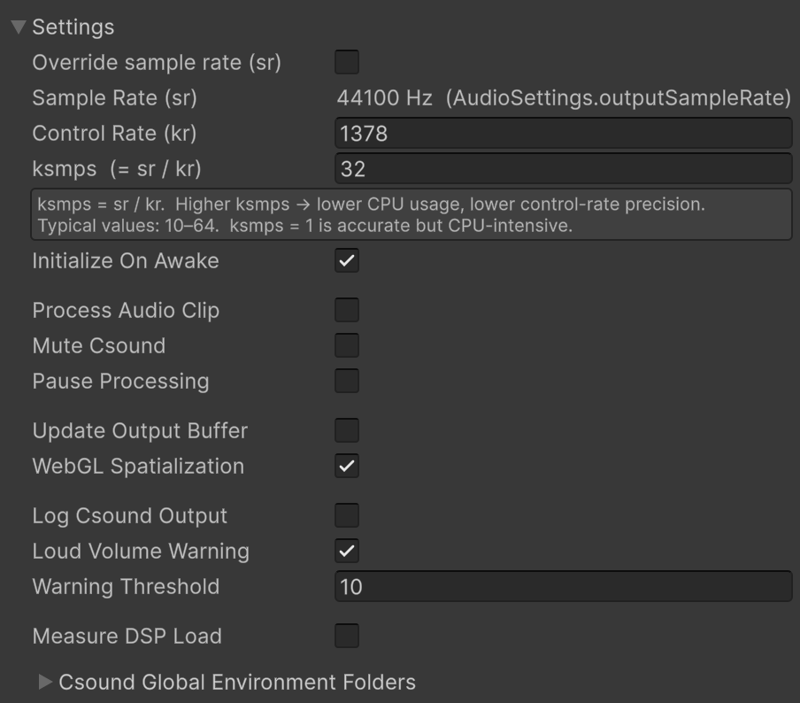

## The Settings foldout ##

> **New in v4.0.0**

The Settings foldout holds what Csound runs at, when it starts, what it does while it runs, what
it sends outward, and what it reports. This page says what each entry does and when you would
touch it.

The entries are grouped, with a blank line between groups, and the order is those five groups.
The last one is made of lenses: those settings report, and leave every sample alone.

---

### What Csound runs at ###

These four are locked while the scene is playing.

| Setting | What it does |
|---|---|
| **Override sample rate (sr)** | Off, `sr` follows the audio device, so Csound's clock and Unity's agree. On, you set it yourself |
| **Sample Rate (sr)** | Csound's rate in Hz. The `sr` written in the csd is ignored either way. While the toggle is off it shows the rate the audio system is **running** at, which is not always the one in **Project Settings → Audio**: that one takes effect when the audio system restarts, which entering play mode does. The **↺** beside it reads the running rate again and hands it to Csound, and changes no project setting |
| **Control Rate (kr)** | Control periods per second: how often k-rate values update, meaning envelopes, LFOs, and the channels you write from C#. Editing it sets ksmps |
| **ksmps (= sr / kr)** | Samples per control period |

**Leave the override off** unless you have a reason. An `sr` that does not match the device makes
Csound run at a different speed than Unity, and notes scheduled ahead arrive at the wrong moment.

`ksmps` is the CPU knob. Csound is called once per control period, so a Unity block of 1024 samples
means 1024 calls at `ksmps = 1` and 32 calls at `ksmps = 32`. Lower is more precise modulation,
higher is cheaper. **10 to 64** is the usual range, and the value in the csd is what you start from.

> On the **IAudioGenerator** path Unity's block size must be an exact multiple of `ksmps`, and the
> console says so at startup when it is not.

---

### When it starts ###

**Initialize On Awake** compiles the csd and starts Csound as the GameObject wakes up. Turn it off
to start it yourself with `Initialize()`, which is what you want when the csd is built at runtime or
depends on something else being ready. See [Lifecycle API](lifecycle.md).

---

### What it does while it runs ###

| Setting | What it does |
|---|---|
| **Process Audio Clip** | On, the AudioSource's clip is fed into Csound's input for an orchestra that reads it with `inch`, and Csound's output replaces it. Off, Csound's output is multiplied by what the AudioSource carries, which is how Unity's 3D panning and mixer effects reach it |
| **Mute Csound** | Silences the output. Csound keeps performing, so the score stays in time and comes back in the right place |
| **Pause Processing** | Silences the output **and** stops Csound performing. No DSP cost, and the score freezes, so unpausing resumes exactly where it stopped |

The difference between the last two is the only thing here worth remembering. **Mute is a fader,
pause is a freeze.** Neither tears anything down, unlike disabling the GameObject or calling
`Stop()`.

Clip audio keeps arriving while muted, so an effect fed by the clip stays warm. It stops while
paused, where nothing would consume it.

---

### What it sends outward ###

Two settings that do not change what this instance plays, and cost something per block or per frame.
Both are off until something is listening.

| Setting | What it does |
|---|---|
| **Update Output Buffer** | Publishes every finished DSP block to `OutputBuffer`, where the main thread can read it. The [Audio Monitor](audio_monitor.md) needs it. One copy per block |
| **WebGL Spatialization** | Sends this instance's position to the csd once a frame, as the channels `azimuth`, `elevation` and `rolloff`. WebGL has no 3D audio of its own, so this is how the orchestra can do it. See [WebGL support](webgl_support.md) |

---

### What it tells you ###

| Setting | What it does |
|---|---|
| **Log Csound Output** | Csound's own messages go to the Unity console. The first place to look when a csd does not sound, and noisy once it works |
| **Loud Volume Warning** | Warns in the console when a sample is louder than the threshold, and silences the samples that are. Silencing a sample leaves a hole in the waveform, so a runaway is heard as distortion, and the warning says so rather than leaving you to look for it in the orchestra. All three audio paths honour it, and a sample that is not a number is silenced whatever this is set to |
| **Warning Threshold** | The value that triggers it. 1 is full scale, so the default of 10 only catches real runaways |
| **Measure DSP Load** | Measures what share of the DSP budget this instance uses, drawn as a bar while playing and inside the nodes of the route graph. It times the audio thread with a stopwatch, so turn it off in a build |

---

### Csound Global Environment Folders ###

A sub-foldout, at the bottom. It tells Csound where to look for sound files, plugins and
soundfonts, per platform. It has a page of its own:
[Environment Variables](environment_variables.md).

---

### Where everything else is ###

The rest of the inspector, from the top:

| Section | For |
|---|---|
| **Csd Asset** | the file this instance compiles. The **↺** button rereads it, the **CREATE** button starts a new one from a template |
| **Settings** | this page |
| **Edit Csd Section** | the csd's text, editable here, with a button to write it back to disk |
| **Test Score Section** | one score event sent by hand while the scene plays |
| **Control Channels** | every channel the `<Cabbage>` block declares, with its range and its current value. Right click the foldout to copy the lot to the clipboard or paste it back |
| **Audio Input Routes** | audio coming in from other instances. See [Audio Input Routing](audio_input_routing.md) |
| **Audio Output Path** | how the audio leaves: `OnAudioFilterRead`, `IAudioGenerator` or `RootOutput`, plus **Fade In**. See [Audio Output Path](audio_output_path.md) |
| **Audio Channels** | the named audio channels this csd publishes, which routes and [CsoundUnityChild](csoundunity_child.md) read |
| **Presets** | load, save and import. See [Presets](presets.md) |
| **Audio Monitor** | waveform, spectrum, spectrogram, Lissajous and oscilloscope. See [Audio Monitor](audio_monitor.md) |
| **UI Layout** | builds a Canvas from the Cabbage `bounds()`. See [UI Components](ui_components.md) |
