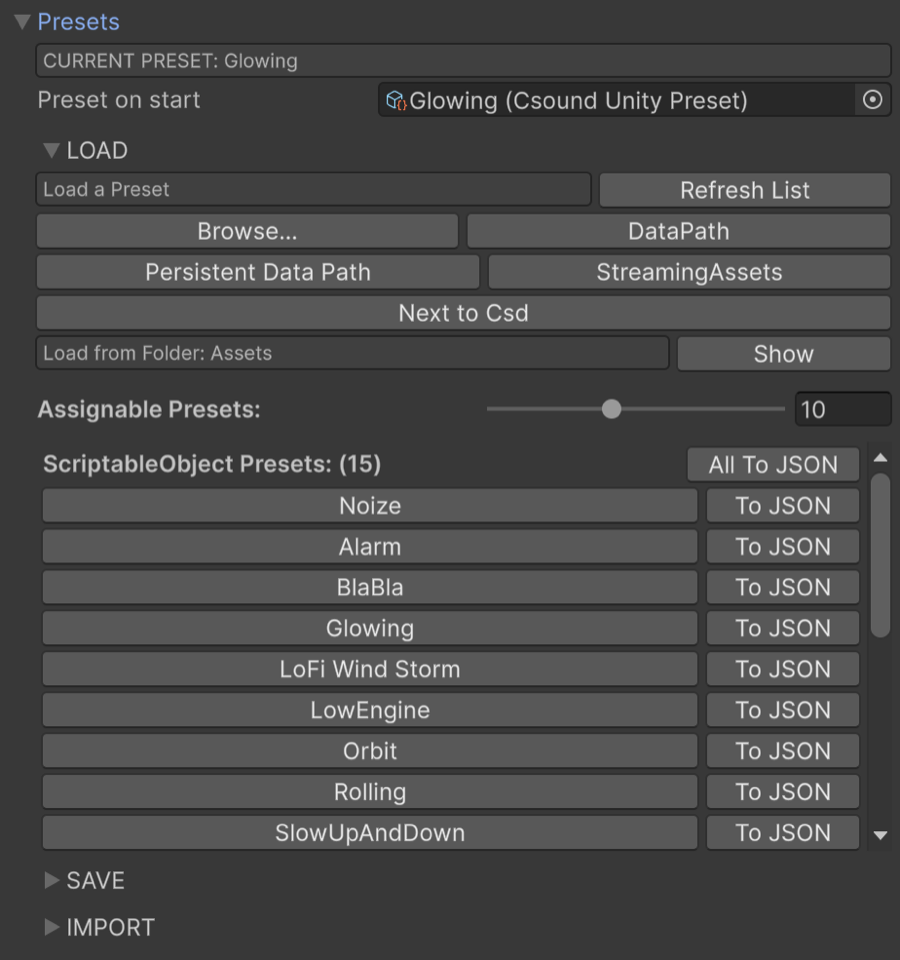
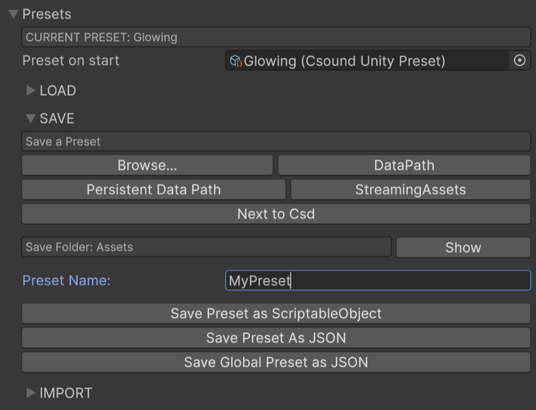
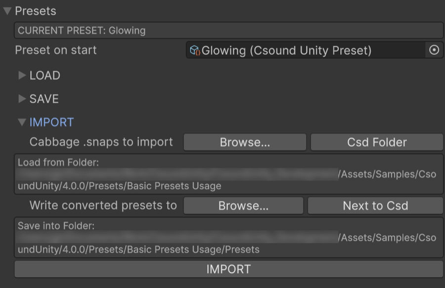

## Presets

New in **CsoundUnity** 3.4.0, it is now possible to save and load **CsoundUnity** presets.

Each preset refers to a csd file, to help keep things clear.  
It holds a list of **CsoundChannelControllers** with specific values, to be retrieved both at Editor time and at Runtime.  

To cover most of the user cases, there are 3 types of presets:

- **SCRIPTABLE OBJECT preset**: this is the type of preset that you will use while developing your application, and that you can give the user as built-in preset (meaning that the user won't be able to override them). 
It works both on the Editor and at Runtime.

- **JSON preset**: this is meant to be used at runtime, when you want to save the channels of a **CsoundUnity** instance but you cannot save a *ScriptableObject*. After saving the JSON file in a known location, you will be able to reload it in a **CsoundUnity** instance which uses the same csd.

- **GLOBAL JSON preset**: this kind of preset is meant to be used when you want to save the whole state of a **CsoundUnity** instance. It is very similar as saving a Unity preset, but this works also at runtime, since it comes as a JSON file. It is useful when you want to carry over for example the **CsoundUnity** settings like the *Environment Settings*.

### The Preset Inspector

The **CsoundUnity** inspector has a *Preset* section which you can expand.

<a name="load"></a>
#### Load



You can select the folder where to look for **CsoundUnityPresets**.
*Browse…* opens a dialogue to choose any folder. The other buttons jump straight to a
destination: *DataPath*, *Persistent Data Path*, *StreamingAssets*, and *Next to Csd* — the
`Presets` folder sitting beside the CSD asset, created if it does not exist. Each button's
tooltip shows the path it will actually select.

The *Refresh List* button scans the selected folder again, useful after adding or removing
files outside Unity, and *Show* reveals the folder in the system file browser.

Assigning a CSD sets both the Load and the Save folder to `Presets` next to it. A folder chosen
by hand afterwards is left alone, so the default never overwrites your choice; *Next to Csd* is
the way back to it.

<a name="scriptable-object-presets"></a>
##### Scriptable Object Presets

The presets listed are the ones related with the csd that this **CsoundUnity** instance is using.  
You can increase the number of the presets displayed acting on the slider on the right of the *Assignable Presets:* label.

Pressing on the name of the preset will set that preset on this **CsoundUnity** instance. This works on the editor and at runtime.  
Hovering on the button will show you the path to that preset.  
You cannot have more than one preset with the same name in the same folder.  
CsoundUnityPresets come with the *.asset* extension.

The *To JSON* button next to each preset name lets you convert that preset in the JSON format,
and *All To JSON* next to the list heading converts every one of them in a single step.
It will be saved in the same folder as the **CsoundUnityPreset** you're converting, unless a *Load Folder* is explicitly set — in that case the JSON is saved there instead.

<a name="json-presets"></a>
##### JSON Presets

The JSON presets listed are **ALL** the json files found inside the project, if no LOAD folder is specified.   
There is no guarantee that all the listed JSONs are related with this CsoundUnity instance (because it would mean loading all the found JSON files).  
Pressing on the name of the preset will set that preset on this **CsoundUnity** instance. This works on the editor and at runtime.  
When you try to load a preset some checks are performed: 

- it has to represent a CsoundUnityPreset
- it has to have the same csdName as this **CsoundUnity** instance

Hovering on the button will show you the path to that preset.  
You cannot have more than one preset with the same name in the same folder.  
The *To SO* button next to each preset name lets you convert that preset into a CsoundUnityPreset asset.
It will be saved in the same folder of the JSON you're trying to convert.

<a name="global-json-presets"></a>
##### Global JSON Presets

A global preset represents a **CsoundUnity** instance.  
The available **Global presets** will be listed in the JSON preset list.
If their name contains the word *global* it will be loaded as a **Global preset**, otherwise it will be loaded as a **CsoundUnityPreset**. Be aware of that if you will need to rename the preset after it was created.  
The **Global JSON presets** listed are searched in the entire project, if no LOAD folder is specified.   

<a name="save"></a>
#### Save



To save a preset, first select your destination folder — the same buttons as the Load section.
If no folder is set at all, the *Assets* folder (aka *DataPath*) will be used.  
Type a preset name: if name is empty a default one (*CsoundUnityPreset*) will be used.  
You can choose to save the preset in the 3 different formats (*ScriptableObject*, *JSON* or *Global*) pressing the related buttons.  
If a file with the same name is found in the same destination folder, it will ask if overwrite it or rename it (if saving as a *ScriptableObject*). If rename is chosen it will add a suffix to the name.   
If saving as a JSON and the JSON file exists at that location, it will simply add a suffix to the name.

<a name="import-cabbage-snaps"></a>
#### Import Cabbage Snaps

You can import [Cabbage snaps](https://cabbageaudio.com/docs/presets/) and create CsoundUnityPresets from them.
Specify the folder holding the *.snaps* files — *Csd Folder* jumps to where Cabbage usually
leaves them — then the destination folder for the converted presets, and press *IMPORT*.
Each *.snaps* needs a *.csd* of the same name beside it.  
A new **CsoundUnityPreset** will be created for each preset contained in each *.snaps* file found in the folder specified. 



### Saving / Loading presets using C#

A preset saved as a *ScriptableObject* is an Editor asset: you can **load** one at runtime by
assigning it to a field like any other Unity asset, but you cannot create one while the game runs.
To save at runtime, write JSON.

```csharp
using System.IO;
using Csound.Unity;
using UnityEngine;

public class PresetSaveLoad : MonoBehaviour
{
    private CsoundUnity _csound;

    private string Folder => Application.persistentDataPath;
    private string PathFor(string name) => Path.Combine(Folder, name + ".json");

    void Start() => _csound = GetComponent<CsoundUnity>();

    // Writes <persistentDataPath>/MySound.json with the channel values as they are now.
    public void Save(string presetName)
    {
        if (!_csound.IsInitialized) return;
        _csound.SavePresetAsJSON(presetName, Folder, overwriteIfExisting: true);
    }

    // Reads it back and applies it.
    public void Load(string presetName)
    {
        if (!_csound.IsInitialized) return;

        var file = PathFor(presetName);
        if (!File.Exists(file))
        {
            Debug.LogWarning($"No preset at {file}");
            return;
        }

        _csound.SetPreset(presetName, File.ReadAllText(file));
    }
}
```

Two things worth knowing:

- `SavePresetAsJSON` defaults to `Application.persistentDataPath` when `path` is null, and without
  `overwriteIfExisting: true` it appends a counter rather than replacing the file.
- `SetPreset` refuses a preset whose `csoundFileName` does not match this instance's, and logs an
  error — so a preset saved from a different csd will not be applied by accident.

---

### Copying channels to the clipboard ###

A preset asset is a lot of ceremony for the quick pass: try a change, dislike it, put the old
values back. The clipboard covers that case, with no file and no asset.

**Right click the Control Channels foldout** for *Copy Channels* and *Paste Channels*. It works in
play mode, which is where that quick pass usually happens. From code it is two calls:

```csharp
csoundUnity.CopyChannelsToClipboard();
csoundUnity.PasteChannelsFromClipboard();
```

What lands on the clipboard is **the same JSON a preset is saved in**, so the two are
interchangeable: you can paste a saved `.json` preset in, or copy the channels and send them to
someone in a chat window.

Pasting is more forgiving than `SetPreset`. It does not refuse a clipboard that came from another
csd: the channels this one declares are applied, and the rest are reported. Moving values by hand
between related csds is the point.

---

### Morphing between presets ###

Applying a preset is a jump. `MorphToPreset` is the same thing over time.

```csharp
csoundUnity.MorphToPreset(dark, duration: 2.5f);
csoundUnity.MorphToPreset(bright, 1f, curve: easeInOut, onComplete: () => Debug.Log("there"));
csoundUnity.StopMorph();   // values stay where the morph had reached
```

Continuous channels are interpolated: the sliders, and both axes of an `xypad`, `hrange` or
`vrange`. A button, a checkbox or a combobox cannot be half way, so they snap, and
`DiscreteChannelMode` says when: `SnapAtEnd` (the default), `SnapAtMidpoint` or `SnapAtStart`.

A duration of zero applies the preset immediately and returns `null`.

---

### Vector Morph ###

Four presets at the corners of a square, and one position inside it.
`BlendPresets` does the blend, and **CsoundUnityVectorMorph** is the component that calls it every
frame so you only move the position.

Add it next to a `CsoundUnity`, drop a preset into each of the four corner fields, and write
`position`. Each axis runs 0 to 1, with (0, 0) at the bottom left.

```csharp
morph.position = new Vector2(mouseX, mouseY);
```

Drive it from an XY pad, from where the player stands, from a MIDI CC, from anything that produces
two numbers. Or turn on **Automate** and let it move by itself along a **Circle**, a **Lissajous**
figure or a **Random Walk**, at the speed you set.

Discrete channels here follow `DiscreteBlendMode`: **Ignore** leaves them alone, which is the
default, and **NearestCorner** takes them from whichever corner currently weighs most.

> It needs all four corners filled. With any of them empty the component does nothing.

---

Every method is listed in the [API reference](html/index.html ':ignore'), under `CsoundUnity`,
`CsoundUnityPreset` and `CsoundUnityVectorMorph`.
