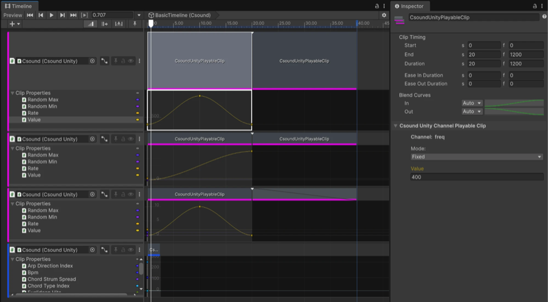
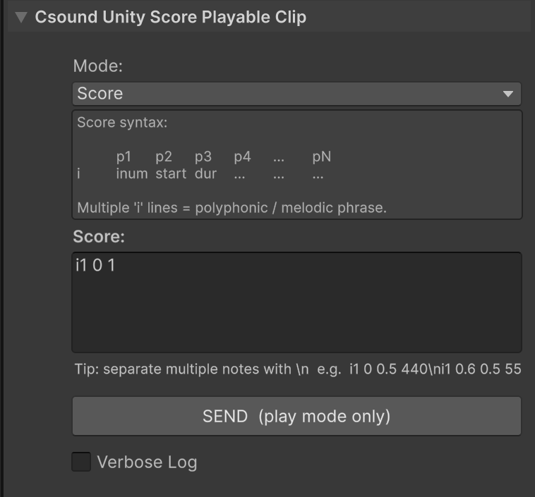
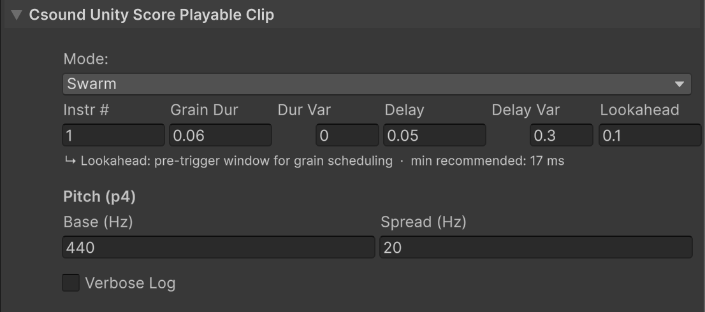
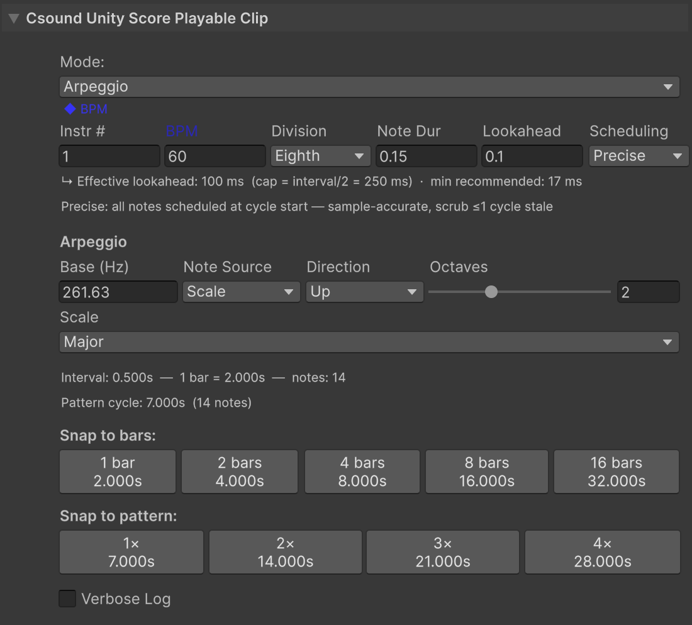
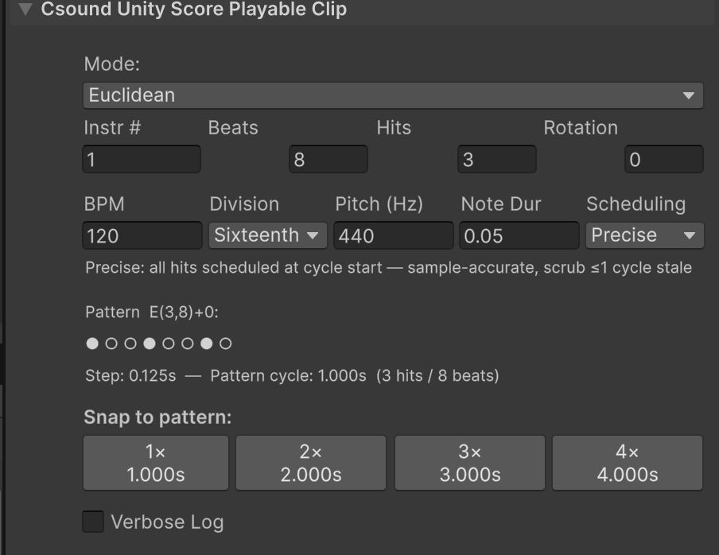
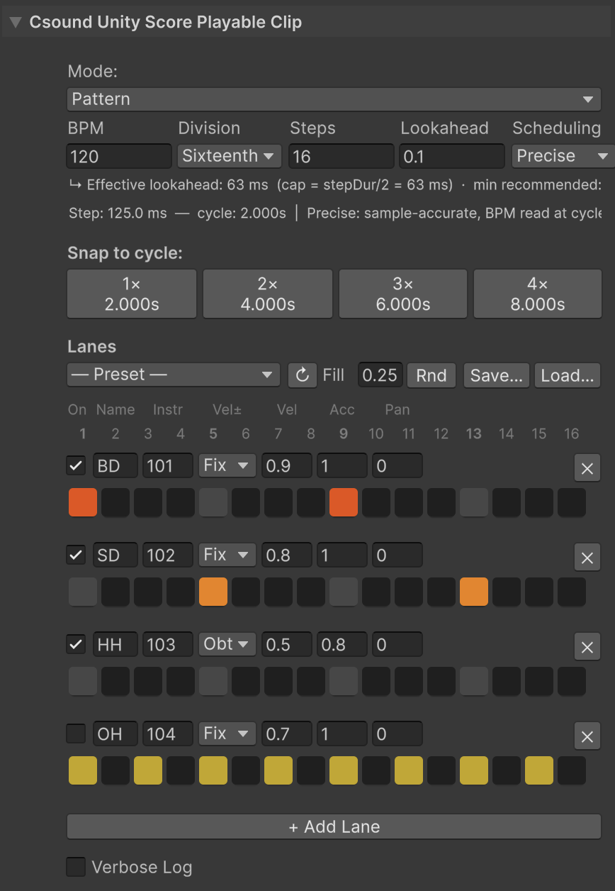
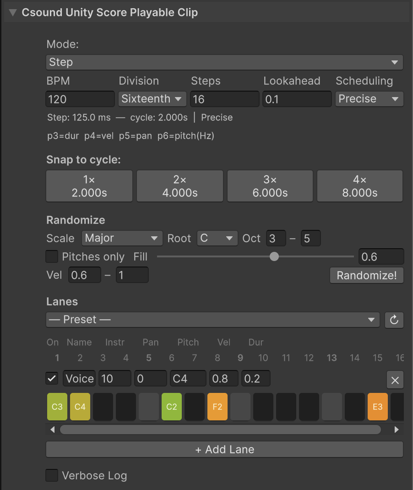
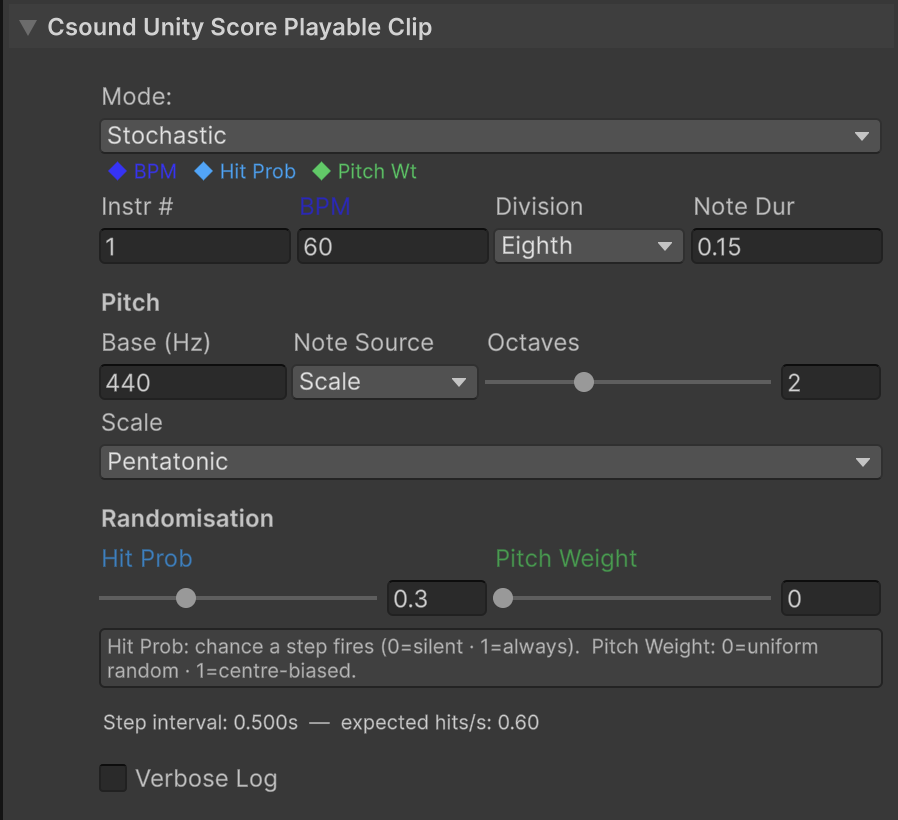
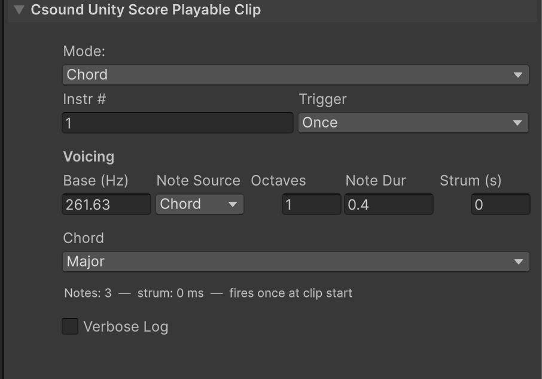

## CsoundUnity Timelines

> **New in v4.0.0**

CsoundUnity Timelines integrates Csound deeply with Unity's Timeline editor. You can trigger score events — single notes, procedural granular swarms, melodic arpeggios, euclidean rhythms, stochastic patterns, and chords, all sample-accurately scheduled inside Csound — and automate any named Csound channel over time to control parameters like filter cutoff, reverb amount, or volume directly from the Timeline.

---

## Requirements

- Unity 2022.3 LTS, the package minimum
- Unity's **Timeline** package (`com.unity.timeline` 1.0.0+) — once installed, the CsoundUnity asmdef detects it automatically and enables the Timelines integration, no manual setup required
- A CsoundUnity component in the scene with a loaded `.csd` file

---

## Track Types

CsoundUnity adds two distinct track types to the Timeline editor:

| Track | Purpose |
|---|---|
| **Score Track** | Triggers Csound score events (notes, grains, arpeggios, patterns) at precise times |
| **Channel Track** | Animates a named Csound channel value over time (parameters, modulation) |

Use a **Score Track** when you want to schedule musical events. Events are sent as Csound score messages and scheduled sample-accurately inside Csound's audio thread.

Use a **Channel Track** when you want to automate a synthesis parameter that your `.csd` reads via `chnget`. Values are updated every Unity frame.

You can combine both track types freely on the same Timeline and bind them to the same CsoundUnity instance.

---

## Setup

### 1. Create a Timeline

1. Open the Timeline window (**Window → Sequencing → Timeline**)
2. Create a new Timeline asset and assign it to a `PlayableDirector` in the scene
3. If your Timeline contains **Score clips** that trigger notes from the very beginning, disable **"Play On Awake"** on the `PlayableDirector` and use `CsoundUnityTimelineStarter` instead (see below)

### 2. Add Tracks

In the Timeline window, click **+** to add a track:

- **CsoundUnity Score Track** — for triggering score events
- **CsoundUnity Channel Track** — for animating Csound channels

For each track, drag your **CsoundUnity** component from the scene into the binding slot on the left.

### 3. Add Clips

Right-click on any track lane and select the corresponding **Add Clip** option. Each clip is configured independently in the Inspector.



Three channel tracks, each bound to a CsoundUnity instance, with the curve of a clip under
its lane and the selected clip in the inspector.



A score clip: the score it sends, the syntax above it, and a SEND button that fires it
while the scene plays.

### 4. CsoundUnityTimelineStarter (Score clips only)

If your Timeline starts with Score clips that fire notes immediately, add the `CsoundUnityTimelineStarter` component to any GameObject in the scene. It waits for Csound to finish initializing before starting the Timeline, ensuring the first note is never lost.

> This is only needed when Score clips are active from the very start of the Timeline. If Score clips start later (after Csound has had time to initialize), you can leave "Play On Awake" enabled.

| Field | Description |
|---|---|
| Director | The PlayableDirector to start (auto-found if empty) |
| Csound | The CsoundUnity instance to wait for (auto-found if empty) |
| Extra Delay | Additional seconds to wait after Csound is ready (default: 0.1s) |

---

## Score Track

A Score Track sends Csound score events from Timeline clips. Each clip has a **mode** that determines what kind of events it generates.

### Animating parameters

Any numeric parameter on a Score clip can be animated over time using Unity's Clip Properties curve editor. Select a clip, then open the **Clip Properties** panel in the Timeline window — you will see a coloured dot next to each animatable field. Click a dot to open a curve editor for that parameter. The inspector shows coloured diamonds next to any parameter that currently has a curve.

---

### Clip Modes

#### Score

Sends one Csound score line when the clip starts. The clip duration is automatically used as `p3`.

| Field | Description |
|---|---|
| Score | A raw Csound score string, e.g. `i1 0 1 440` |

Useful for sustained pads, one-shot sounds, or any event that fires once.

---

#### Swarm



Grain duration and delay, each with the variation that scatters them, and the pitch the
grains are drawn around.

Repeatedly fires short grains for the duration of the clip, creating a granular texture.

| Field | Description |
|---|---|
| Instr N | Csound instrument number |
| Grain Duration | Duration of each grain in seconds (`p3`) |
| Duration Variation | Randomises grain duration per grain (0 = fixed, 1 = ±100% of Grain Duration) |
| Delay | Time between grain onsets in seconds |
| Delay Variation | Random variation on the delay (0 = regular, 1 = fully random) |
| Pitch Base (Hz) | Center frequency for grains (`p4`) |
| Pitch Spread (Hz) | Random spread around the center frequency |
| Lookahead | How far ahead (in seconds) grains are pre-scheduled into Csound's queue |

**Lookahead guidance:**
- Too low (e.g. `0.01s`) — grains may arrive late during a slow frame, causing audible gaps
- Too high (e.g. `0.5s`) — queued grains will continue sounding for that long after the clip stops
- Recommended range: `0.05` – `0.1s`

The `.csd` receives each grain as: `i{N} {onset} {duration} {frequency_hz}`

---

#### Arpeggio

Plays a repeating melodic pattern across a scale or chord, synced to a tempo.



The rhomb over BPM says that value is animated. The lines above the buttons work out what the
settings produce, 14 notes over a 7 second cycle, and the buttons snap the clip's length to whole
bars or to whole cycles of that pattern.

**Timing**

| Field | Description |
|---|---|
| BPM | Tempo of the arpeggio |
| Division | Note grid: Whole, Half, Quarter, Eighth, Sixteenth, Thirty-second |
| Note Duration | How long each note sounds (seconds). Shorter than the interval = staccato |
| Lookahead | How far ahead (in seconds) each note is pre-scheduled |
| Scheduling | **Precise**: notes are scheduled one cycle at a time — sample-accurate timing, at most one stale cycle after scrubbing. **BPM-note**: BPM is re-read at every note — enables tempo animation (accelerando/rallentando) within a cycle, timing ±1 frame |

**Note Source**

Choose **Scale** or **Chord** as the pitch source.

*Scale mode:*

| Field | Description |
|---|---|
| Pitch Base (Hz) | Root frequency (e.g. 220 = A3) |
| Scale | Chromatic, Major, Minor, Pentatonic, Dorian, Phrygian, Lydian, Mixolydian, HarmonicMinor |
| Octaves | How many octaves to span (1–4) |
| Direction | Up, Down, UpDown (ping-pong), Random |

*Chord mode:*

| Field | Description |
|---|---|
| Pitch Base (Hz) | Root frequency |
| Chord | Unison, MinorThird, MajorThird, Fourth, Fifth, Major, Minor, Dim, Aug, Sus2, Sus4, Major7, Minor7, Dom7, Dim7, m7b5, mMaj7, Aug7, AugMaj7, Major9, Minor9, Dom9, Add9, Major11, Minor11, Dom11, Major13, Minor13, Dom13, Custom |
| Octaves | How many octaves to span |
| Direction | Up, Down, UpDown, Random |

For **Custom** chord, enter semitone intervals from the root using the **+** / **−** buttons.

**Snap to Bars / Snap to Pattern**

The Inspector shows buttons to snap the clip duration to musically meaningful values:

- **Snap to bars** — sets the clip to 1, 2, 4, 8, or 16 bars at the current BPM
- **Snap to pattern** — sets the clip to exactly 1×, 2×, 3×, or 4× the full pattern cycle duration

The Inspector also displays the note interval, bar duration, note count, and full cycle duration for reference.

**CSD requirements:** `i{N} {onset} {duration} {frequency_hz}`

---

#### Euclidean



The row of dots is the pattern the three numbers produce, so a rotation or a hit more is
visible before the scene runs.

Distributes a number of hits as evenly as possible across a fixed number of steps, using the Bjorklund algorithm. Produces rhythmic patterns commonly found in world music and electronic percussion.

| Field | Description |
|---|---|
| Instr N | Csound instrument number |
| BPM | Tempo |
| Division | Step grid: Whole, Half, Quarter, Eighth, Sixteenth, Thirty-second |
| Note Duration | Duration of each triggered note |
| Steps | Total number of steps in the pattern (1–32) |
| Hits | Number of active hits distributed across the steps (1–Steps) |
| Rotation | Rotates the pattern by N steps (shifts the downbeat) |
| Scheduling | Same as Arpeggio: Precise or BPM-step |

**CSD requirements:** `i{N} {onset} {duration} {frequency_hz}`

---

#### Pattern and Step

Two sequencers that share the same grid and the same timing fields, and differ in what a step
carries. **Pattern** is a drum machine: a step is on or off, and the lane decides velocity and pan.
**Step** is a melodic sequencer: each step carries its own pitch, velocity and duration, and the
lane holds the values a step falls back to when it leaves one at zero.

The score events differ accordingly: a pattern lane sends
`i{N} {onset} {duration} {velocity} {pan}`, a step lane one field more,
`i{N} {onset} {duration} {velocity} {pan} {pitch}`.



A pattern clip: four lanes, one instrument each, and the grid that says which steps fire.



A step clip: the same grid, with a note written into each step and a Randomize that fills
the lane from a scale.

A step sequencer with multiple independent lanes (instruments), each with its own toggle grid. Every lane fires its Csound instrument on each active step. Typical use: drum machines, rhythmic sound design.

**Timing**

| Field | Description |
|---|---|
| BPM | Tempo of the pattern |
| Division | Step grid: Whole, Half, Quarter, Eighth, Sixteenth, Thirty-second |
| Steps | Total number of steps per cycle (1–32) |
| Lookahead | How far ahead (in seconds) the cycle is pre-scheduled into Csound. Increase if you hear occasional late starts (see note below) |
| Scheduling | **Precise**: the entire cycle is sent to Csound at once — sample-accurate, immune to frame jitter. **BPM-step**: one step at a time, allows live BPM changes within a cycle, timing ±1 frame |

**Lanes**

Each lane represents one instrument and has:

| Field | Description |
|---|---|
| Label | Display name (for the Inspector grid) |
| Instr N | Csound instrument number to trigger on active steps |
| Enabled | Mutes the entire lane without removing it |
| Velocity Mode | **Fixed**: all steps use the same velocity. **Offbeat**: alternate steps use a lower velocity for a natural groove feel |
| Velocity | Base velocity (0–1), sent as `p4` |
| Accent Velocity | Velocity for downbeat / accented steps |
| Pan | Stereo position (−1 left, 0 centre, +1 right), sent as `p5` |
| Pattern | The toggle grid: one button per step, click to activate or deactivate |

**Snap to bars / Snap to pattern** buttons in the Inspector set the clip duration to musically aligned values.

**CSD requirements:** `i{N} {onset} {duration} {velocity} {pan}`

**Lookahead guidance (Precise mode)**

In Precise mode, the entire cycle is pre-scheduled `patternLookahead` seconds before it starts. If a Unity frame takes longer than the lookahead window, the cycle fires late:

- Default lookahead: `0.1 s` (100 ms) — robust for most hardware
- Increase to `0.2 s` or more if you hear occasional missed beats on slower machines
- Very high values (> cycle duration) are safe but unnecessary

> **Performance note:** Audio timing in Unity is tightly coupled to CPU performance. Always test builds with the power adapter connected. Without it, CPU throttling can introduce timing irregularities that make even correct code sound out of time.

**Changing the pattern from code**

Use the Pattern runtime API (see [Runtime API](#runtime-api) below) to toggle steps, mute lanes, and change tempo while the Timeline is playing.

---

#### Stochastic



The rhombs over the fields mark what the clip is animating: here BPM, hit probability and
pitch weight all have a curve.

Fires notes at a regular rhythmic grid, with each step having a probability of triggering. Pitch is chosen randomly from a scale or chord, optionally weighted toward the center.

| Field | Description |
|---|---|
| Instr N | Csound instrument number |
| BPM | Tempo |
| Division | Step grid |
| Note Duration | Duration of each note |
| Note Source | Scale or Chord |
| Pitch Base (Hz) | Root frequency |
| Scale / Chord | Pitch set (same options as Arpeggio) |
| Octaves | How many octaves to span |
| Hit Probability | Chance (0–1) that any given step triggers a note |
| Pitch Weight | 0 = uniform random pitch; 1 = strongly weighted toward the center pitch |

**CSD requirements:** `i{N} {onset} {duration} {frequency_hz}`

---

#### Chord

Fires a set of notes simultaneously (or as a strum) on a trigger.



The line under the fields counts the notes the settings produce and says when they fire, so a
chord that comes out thinner than expected is visible before the scene runs.

| Field | Description |
|---|---|
| Instr N | Csound instrument number |
| Note Duration | Duration of each note |
| Note Source | Scale or Chord |
| Pitch Base (Hz) | Root frequency |
| Chord Type | Chord voicing |
| Octaves | How many octaves to voice the chord across |
| Strum Spread | Seconds between successive notes (0 = block chord, >0 = guitar-style strum) |
| Repeat | When enabled, re-triggers the chord at the specified Division throughout the clip |
| Division | Re-trigger interval (only when Repeat is enabled) |

**CSD requirements:** `i{N} {onset} {duration} {frequency_hz}`

---

### Clip Duration and Looping

For Arpeggio and Euclidean modes, the clip duration should be an exact multiple of the pattern cycle to avoid a partial last cycle. Use **Snap to Pattern** to set the duration automatically.

When a clip ends, any notes still pending in Csound's queue are cancelled immediately (`i -N 0 0`). Transitions between clips are clean with no overlap or double-triggering.

---

## Channel Track

A Channel Track animates the value of a named Csound channel over time, letting you control any `chnget`/`chnset` parameter directly from the Timeline.

### Setup

1. Click **+** in the Timeline window and select **CsoundUnity Channel Track**
2. Select the channel name from the dropdown (populated automatically from the CSD file) or type the name manually
3. Drag your **CsoundUnity** component into the track binding slot
4. Right-click the lane and select **Add CsoundUnity Channel Clip**

### Clip Modes

Each Channel clip has a **Mode** that determines how its value is generated:

| Mode | Behaviour |
|---|---|
| **Fixed** | Outputs a constant value for the duration of the clip |
| **Random (S&H)** | Jumps to a new random value at a set rate (sample and hold) |
| **Random Smooth** | Interpolates smoothly to a new random target at a set rate |

For Random modes, set **Min**, **Max**, and **Rate (Hz)**. The **Use CSD range** button populates Min and Max from the channel definition in the CSD file.

### How it works

The mixer blends values across overlapping clips using Unity's standard Timeline weight system:

- **No overlap** — the channel is set to the clip's value while the clip is active
- **Overlapping clips** — values are blended proportionally using each clip's ease weights
- **Gap between clips** — the channel holds its last written value (does not reset to zero)

### CSD side

```csound
kCutoff chnget "cutoff"
```

The channel is updated every Unity frame, so resolution is limited to the frame rate. For sample-accurate timing, use score events instead.

### Tips

- Use **ease in / ease out** on clips (right-click → Edit) to create smooth ramps
- Stack multiple Channel Tracks to control several parameters on the same CsoundUnity instance independently

---

## Sequencer UI at runtime

Pattern and Step clips can be given a **sequencer UI**: a panel the player uses while the timeline
runs, with a grid of steps, a tempo slider, one chip per clip and a popup for each step. It is
generated out of UGUI objects in your scene, so it is yours to restyle, and it drives the clips
through
[CsoundUnityTimelineController](#csoundunitytimelinecontroller).

The two builders are **StepUIBuilder** and **PatternUIBuilder**, one per mode.

### Making one

1. Add **StepUIBuilder** or **PatternUIBuilder** to a GameObject. They are under
   **Scripts > Csound.Unity.Timelines** in the Add Component menu.
2. Leave **Controller** empty and it finds a `CsoundUnityTimelineController` in the scene, or assign
   one. Leave **Container** empty and a Canvas is made for you, or point it at a RectTransform of
   your own.
3. Press **Generate UI**. The widgets are created as real children, in one undo step, together with
   an EventSystem if the scene had none, because without one the panel draws and answers nothing.
   **Clear UI** removes them again.

Generate UI reads the clip the panel will drive, so the timeline has to hold at least one clip of
that mode. It is an edit mode button: in play mode it is greyed out, and the panel that is already
in the scene is the one that plays.

| Field | Description |
|---|---|
| **Controller** | The controller to read clips from. Left empty, one is found in the scene |
| **Container** | Where the panel is built. Left empty, a Canvas is created |
| **Bpm Min**, **Bpm Max** | The ends of the tempo slider |
| **Active Color**, **Inactive Color** | A step that is on, and one that is off |
| **Panel Color**, **Header Bg Color**, **Popup Bg Color** | The panel, its header row and lane labels, and the per step popup |

### Using one

- **The step grid**: a click turns a step on or off. In Step mode each step also carries a pitch, a
  velocity and a duration, in a popup that opens on the step.
- **The chips**, one per clip of that mode: the panel follows whichever clip is playing, and the
  border moves with it. Click a chip to lock the panel to that clip, and click it again to go back
  to following. A clip with a different number of lanes or steps needs a panel of another shape, so
  showing it rebuilds the widgets: with clips of mixed sizes that happens at every clip boundary
  while it follows, and an open per step popup closes with it. Clips of the same shape cost nothing
  to move between.
- **BPM**, the slider at the top, changes the clip's local tempo. When the clip follows shared tempo it is labelled **Master BPM** and changes the controller instead.
- **Randomize**, which fills the grid again. In Step mode it draws pitches from a scale and a root
  you pick.
- **Preset**, a dropdown of the built-in patterns. See [Sequencer presets](#sequencer-presets).
- **Reset**, which puts back what the clip holds, throwing away what the panel changed.
- **Restore**, which appears only when there is something to put back: see
  [the autosave](#the-autosave).

The panel edits the copy of the clip the graph is running, never the clip asset, so what you build
with it is gone when play mode ends unless you save it. That is what
[Score State](#score-state) is for.

---

## Sequencer presets

A preset fills the **lanes** of a Pattern or Step clip: which steps are on, and their pitch,
velocity and duration. It is the quick way to get a groove in place and change it from there.

Presets are applied from two places, and **they are only ever applied**: there is no button that
saves one.

| Where | What it offers |
|---|---|
| The **Preset** dropdown in the clip inspector | the built-in presets, then every `SequencerPreset` asset in the project. The **↻** button next to it looks for assets again |
| The **Preset** dropdown in a runtime panel | the built-in presets only |

The built-ins for Pattern are drum grooves: Basic Rock, Disco, Hip-Hop, Reggae (One Drop), Funk,
Half-Time, Samba, Bossa Nova, House, Breakbeat and 2-Step. For Step they are melodic figures:
Alberti Bass, Walking Bass, Funk Bass, Octave Riff, Pentatonic Lick, Lead + Bass and Parallel
Thirds. A preset is written onto as many lanes and steps as both sides have, so a clip with fewer
lanes takes the first ones and the rest is left alone.

### Your own presets

Create one from **CsoundUnity > Sequencer Preset** in the asset menu. It opens with its own editor,
where you set the mode, the step count, the division and the lanes, and it then appears in the clip
inspector dropdown.

It is filled by hand: nothing reads a clip into it. **To save what a clip plays, use a
[clip snapshot](#score-state) instead**, which carries the whole clip rather than its lanes, and
works in every mode and not only in Pattern and Step.

| Field | Description |
|---|---|
| **Preset Name** | The name shown in the dropdowns |
| **Mode** | Pattern or Step. It only appears for clips of that mode |
| **Step Count**, **Division** | The grid it was written for |
| **Lanes** | One per lane: its label, the instrument its notes go to, the pitch, velocity and duration a step falls back to, the pan, and the steps themselves |

A preset carries no tempo, no lookahead and none of the per mode parameters. Those belong to the
clip, and a saved state is what keeps them.

---

## Score State

A **Score State** holds what sequencer clips play, so it can be put back. It comes in two sizes,
and they are the same asset and the same format:

| | Saved from | Holds |
|---|---|---|
| **A whole timeline**, the *timeline state* | the **Timeline state** section at the bottom of the CsoundUnityTimelineController inspector | one state per sequencer clip, each tied to the clip it came from |
| **One clip**, a *clip snapshot* | the **Clip snapshot** foldout at the bottom of a Score clip's own inspector | that clip's state alone, tied to nothing, so it can go onto any clip of the same mode, or of another mode when you ask for it out of play mode |

You can also create an empty one from **CsoundUnity > Score State** in the asset menu and fill it
with **Paste JSON** in its inspector.

[Workflows](#workflows) below walks through what this is for, step by step, and [what surprises
people](#what-surprises-people) collects the details that are easy to read the wrong way.

Both sizes are the same type, so Unity's object field can only ever show *Csound Unity Score State*:
the line under it says what the asset actually holds, `1 clip · Pattern` or `8 clips · 2 tracks`.

It works in **every** clip mode, not only in Pattern and Step, and it saves what the clips
**play**: the mode, the grid, the lanes with their steps, velocities and durations, the mutes, the
tempo and the per mode parameters, down to the arpeggio's scale and the euclidean's rotation. It saves nothing of how the timeline is
**built**: track order, clip positions and durations, blends, animation curves and track bindings are
not part of a saved state and are left exactly as they are.

### The clip is the master, the sequencer UI is the rough copy

Everywhere below, **sequencer UI** means the UGUI panel generated at runtime by StepUIBuilder or
PatternUIBuilder, never an inspector. Only **Pattern and Step clips** have one: for the other six
modes nothing said here about it arises, and a state is saved and applied from the inspectors
alone.

A sequencer UI writes into the copy of the clip the graph is running, never into the clip
itself, which is where Unity leaves every other runtime edit. So:

- editing the **sequencer UI** changes nothing in the clip, and the clip inspector keeps showing the
  stored values
- editing the **clip** makes the Timeline rebuild its graph, which starts every sequencer clip of that
  timeline again from what it holds. Whatever the sequencer UI had changed, on every clip, is gone

Saving a state is how what the sequencer UI built is made permanent, or carried to another
session.

### The recovered timeline state

The state a rebuild would have thrown away is not lost: the controller reads it first and holds it
as the recovered timeline state, named `~autosave`. While there is one, a **Restore** button appears
in the sequencer UI next to Reset, and the controller inspector offers to restore or forget it. `RestoreAutosave()` does the same
from code.

The controller names the clips it is holding, so you know what is on offer before taking any of it
back.

One clip at a time: the **Clip snapshot** foldout of a clip the recovered state holds offers
**Restore this clip**, which writes that clip alone and leaves the others as they are. A clip taken
back leaves the recovered state, so what is offered is always what is still missing, and once the
last one is taken back the offer goes away by itself. `RestoreAutosaveOf(behaviour)` does the same
from code, and `AutosaveHolds(behaviour)` says whether there is anything to take back.

Only the clips that differ from what they held when they were collected go into it. A clip nobody
touched plays what its asset holds and the rebuilt graph gives it back by itself, so holding it
would offer a restore that changes nothing. A later rebuild adds what it takes to what is already
held, so one rescue does not throw away another nobody has taken back yet.

It lives in memory, so it is gone when play mode ends. Save it to an asset to keep it.

### Saving and applying

One rule, the same for both paths: **outside play mode they read and write the clips, in play mode
they read and write what the graph is running.**

| | Outside play mode | In play mode |
|---|---|---|
| **Save** and **Copy JSON** | what the clips hold | the running state, sequencer UI edits included |
| **Apply** and **Paste** | the clips, permanently, undone with ctrl-Z | the running behaviours, lasting as long as play mode, and no asset is touched |

A **Save** made while it plays still writes an asset you keep, so nothing you built with a sequencer UI is
lost: save it, leave play mode, and apply it to the clip to make it what the clip holds from then
on. Only **Apply** is the temporary one. **Copy JSON** puts it on the clipboard, which the next copy
overwrites.

"In play mode" means the application is playing, not that sound is coming out: a director paused
mid-clip still has running behaviours, and that is what these read.

Which copy a clip's foldout works on is found through the controller that is running that clip, not
guessed from the asset: the same timeline can be driven by more than one director. When nothing is
running the clip, or more than one director is, the foldout says so and its buttons stay disabled
rather than quietly working on the clip instead.

```csharp
// while the timeline plays
var state = controller.CaptureState();   // read the clips as they are now
controller.ApplyState(state);            // and put that back later
controller.RestoreAutosave();            // or what the last rebuild would have lost
```

**When a restore is heard.** It lands like any other runtime edit: the continuous values at once,
while the values a cycle latches (scale, octaves, euclidean hits and rotation, arpeggio direction,
chord type) and the events already scheduled in Csound follow from the next cycle. The step the
sequencer is on is left alone, so a restore does not make the sequence jump.

### One clip at a time

A clip's own inspector, the one the Timeline window shows when you select a clip, has a
**Clip snapshot** foldout at the bottom:

- **Save clip snapshot** writes everything that clip plays into an asset of its own.
- **Apply to this clip** writes a saved state back onto it. The clip you are looking at is the
  target, so nothing is matched by id or by name: that is why a state taken from one clip can be
  applied to another.
- **Copy JSON** and **Paste JSON into this clip** do the same without an asset, which is the quick
  way to make one clip play what another one plays.

Outside play mode, applying one is **permanent and undoable**, like any other edit to a clip: it
writes the clip asset and ctrl-Z takes it back. In play mode it writes the running copy instead, so
it lasts until you stop, and the clip is untouched.

**A clip snapshot is a preset.** It is saved with no timeline and no clip id, so it is never
refused for belonging somewhere else, and it fits any clip of the same mode. The mode has to agree
unless you say otherwise, because the fields that carry a pattern mean different things in each one.

Out of play mode the foldout offers every state it holds, whatever mode it was saved in, and the
button says what writing one would do: **Apply and change mode to Pattern** in place of **Apply to
this clip**. A clip is created in a mode, so without this a preset of another mode would mean
setting the dropdown first, every time. It replaces everything the clip plays, and one ctrl-Z takes
it back. A pasted state of another mode goes in the field rather than being written, so the button
says it there too.

While the graph runs only this clip's mode is offered, because the sequencer UI builders collect the clips by
mode when the graph is built: a clip that changed mode under them would be shown by the builder of
the mode it no longer is.

A timeline state can be used here too: the foldout lists the states in it that match
this clip's mode, and you pick which one to write. That is how one clip takes what another clip of
the same timeline was playing.

### Clip ids

A saved state finds each clip again by an id the clip carries, so reordering a timeline or renaming a
clip does not write one clip's pattern into another. Clips made before this version have none, and
duplicating a clip copies the id of the clip it came from: in both cases the controller inspector
says so and offers **Assign clip ids**, which gives their own to the clips that need one.

The **Clip snapshot** foldout of a clip shows the id it carries, or says it has none and is matched
by name. It is read only: an id naming no state in a snapshot leaves the clip untouched rather than
guessed at, so one written by hand would stop the clip being written at all, and say nothing about
it. Right-click the line to copy it, or to clear it so **Assign clip ids** gives a fresh one.

Without usable ids a state falls back to the clip name, which is the name the Timeline window shows
and not the name of the clip asset, and only where that name belongs to one clip: two clips called the same thing are left as they are and named in the console. A clip that has
an id which matches nothing in the state is left alone rather than guessed at.

The clips that nothing identifies are written by the order they sit in only if you tick **Match the
rest by their order on the track**, which is off. Two clips of one name swapped on the track read exactly like two clips
nobody touched, so position cannot tell one from the other: the tick is how you say that the order is
what you mean. Even then it is refused unless the counts agree and the name saved at each position is
still the name there.

A state taken from another timeline is not applied. The controller inspector says which timeline it
came from and offers to apply it anyway; from a script, `ApplyState` takes a second argument for
that.

A state is never applied to a clip running another mode: the fields that carry a pattern mean
different things in each, and the console says which clips were left alone and why.

### Workflows

Six things a Score State is for, each in a few steps. They all rest on the one rule above: outside
play mode the clips are read and written, in play mode what the graph is running is.

**1. Keep what you built with a sequencer UI.** This is why the feature exists, and it concerns
Pattern and Step clips, the two modes that have one. A sequencer UI writes into the copy the graph
runs, and that copy is gone when play mode ends.

1. Enter play mode and build the thing with the sequencer UI: steps, lanes, velocities, tempo.
2. Still in play, open the controller inspector and press **Save the state of N clip(s)**, or, for
   one clip, select it and press **Save clip snapshot** in its **Clip snapshot** foldout.
3. Leave play mode. The clips are as they were, and the asset holds what you built.
4. Press **Apply state** to write it onto the clips for good. One ctrl-Z takes it back.

**2. Get back what a graph rebuild threw away.** Changing any clip field while the graph runs makes
Timeline rebuild it, and every sequencer UI edit on every clip of that timeline goes with it.

1. The controller notices and keeps what would have been lost as the recovered timeline state.
2. A **Restore** button appears in the sequencer UI, next to Reset, and the controller inspector
   offers **Restore it** and **Forget it**. Both put back every clip at once, and
   `RestoreAutosave()` does the same from code.
3. For one clip alone, use **Restore this clip** in that clip's **Clip snapshot** foldout. The rest
   of the recovered state is kept.
4. It lives in memory only. To keep it past play mode, save it as an asset first.

**3. Put one clip's pattern onto another clip.** A clip snapshot carries no identity, so it fits
anywhere.

1. Select the clip in the Timeline window, open **Clip snapshot**, press **Save clip snapshot**.
2. Select another clip, assign that asset in the **Snapshot** field, press **Apply to this clip**.
3. For a clip in another mode, out of play mode, the button says **Apply and change mode to X** and
   the clip takes that mode. That is what a clip just created needs, since every clip starts in
   Score mode.
4. **Copy JSON** and **Paste JSON into this clip** do the same through the clipboard, with no asset.

**4. Switch between versions of a piece while it plays.** Several states over the same clips are
several versions.

1. Out of play mode, press **Assign clip ids** on the controller, so each state finds its own clip
   however the timeline is reordered later.
2. Build and save one state per version.
3. At runtime call `ApplyState(state)`, or assign one to the controller's **Timeline state** field
   and call `ApplyAssignedState()` from a button or any UnityEvent.
4. In play mode this changes only what is running, so the timeline asset is never touched.

**4b. Save after the director has stopped.** A stopped director leaves its behaviours holding the
state they ended with, so nothing you built is lost when a timeline reaches its end.

1. **Save** and **Copy JSON** keep working, in the clip foldout and in the controller section, and
   give you exactly what was last played.
2. **Apply** and **Paste** go grey, with the reason written: nothing is running the clips, so
   nothing would receive what you wrote.
3. Press play again and the state is collected afresh, so from then on everything works as usual.

**5. Try something in play without committing to it.** Applying in play lasts as long as play mode.

1. While the graph runs, assign a state and press **Apply state**, or **Apply to this clip**.
2. Listen. The clips in the Timeline window do not change.
3. Leave play mode and everything is as it was. To keep what you heard, save it first: a save in
   play writes an asset, and only applying is temporary.

**6. Take the work to another timeline, or another project.** A state writes onto clips that are
already there, so the clips have to exist first.

1. **Duplicate the timeline asset** rather than starting an empty one, and the clips come with it.
2. Assign the copy to a director, assign the state, press **Apply state**.
3. Between projects, **Copy JSON** on the controller, then create an empty asset from **CsoundUnity
   > Score State** in the other project and press **Paste JSON** in its inspector.
4. If the clips are rebuilt by hand instead, give them the names the state lists, or tick **Match
   the rest by their order on the track** when every clip lines up.

### What surprises people

- **A sequencer UI never writes the clip.** It writes the copy the graph runs, like every other
  runtime edit in Unity. The clip inspector keeps showing the stored values while you hear something else.
- **Touching a clip field in play mode is destructive.** It rebuilds the graph, and every sequencer UI edit
  on every clip of that timeline goes. The recovered state is there for exactly this.
- **A save in play mode is permanent, an apply in play mode is not.** Saving writes an asset you
  keep. Applying reaches only what is running.
- **A state does not create clips.** It holds what clips play, not the timeline: positions,
  durations, track order and bindings are not in it.
- **Clips are matched by the name the Timeline window shows**, not by the name of the clip asset,
  which Unity gives after the type and is the same for every clip. Ids beat names, and a clip
  carrying an id the state does not know is left alone rather than guessed at.
- **Duplicating a clip duplicates its id.** The controller inspector says so, and **Assign clip
  ids** gives fresh ones to the clips that need them.

## Troubleshooting

**First clip starts late or sounds out of time**
→ Disable **Play On Awake** on the `PlayableDirector` and add `CsoundUnityTimelineStarter` to the scene.

**Gap of silence at the end of each cycle (Arpeggio / Euclidean)**
→ Use **Snap to Pattern** to align the clip duration to the exact pattern length. Check that `Note Duration` is not shorter than the note interval if you want legato.

**Notes keep sounding after scrubbing or stopping**
→ The instrument number must be a plain integer (e.g. `1`, not a named instrument) for `i -N 0 0` to work. If the instrument uses fractional numbers, they will not be cancelled.

**Channel value jumps instead of ramping**
→ Add ease in / ease out to the Channel clip (right-click → Edit clip). For longer ramps, overlap two clips with opposing ease curves.

**No channels appear in the Channel Track dropdown**
→ Make sure the CsoundUnity component has a CSD file assigned. The channel list is read from the CSD at import time.

**Everything plays too fast, with silence between one clip and the next**
→ Plugging headphones in, or any other change of output device, can move the rate the device runs
at, and Unity does not always follow. It keeps rendering at the rate it started with while the
device consumes it at another, so everything is transposed and runs early, and the gap between clips
is what is left of a cycle that finished too soon. Nothing is wrong with your clips.
→ The quick fix is to make Unity read the device again: in **Project Settings → Audio**, set
**System Sample Rate** to any value, then back to the one it had. Restarting the editor does the
same, and is not needed. Giving the setting a rate of its own, rather than the 0 that follows the
system, keeps Unity where it is when the device changes under it.
→ Where each stage takes its rate from, the input device included, is in
[Which rate the input device should be on](native_audio_input.md#which-rate-the-input-device-should-be-on).

**Pattern (or other modes) sounds irregular / out of time in a build**
→ If on a laptop, always test with the **power adapter connected**. Without it, macOS and Windows reduce CPU clock speed (throttling), introducing frame timing jitter that can make the patterns sound out of time. This applies especially to audio-intensive builds. If irregularities persist with the adapter connected, try increasing the `Lookahead` value on the clip (e.g. from `0.1` to `0.2` s).

---

## Runtime API

You can read and write parameters on a Score clip while the Timeline is playing. Each clip exposes a
set of typed setters on `CsoundUnityScorePlayableBehaviour`. There are two ways to reach one:
**CsoundUnityTimelineController**, which finds the clips for you and addresses them by instrument number,
or the playable graph by hand.

### CsoundUnityTimelineController

Add it to any GameObject and assign the **Director**. It has no entry of its own in the Add Component
menu, so it is under **Scripts > Csound.Unity.Timelines > Csound Unity Timeline Controller**. It
subscribes to the director, traverses the PlayableGraph one frame after it starts playing, caches
every score behaviour it finds, and lets you reach them by the clip's **Instr N** instead of by
position in the graph.

**It is there because a clip asset is not what plays.** The `template` you fill in the clip inspector
is copied when the graph is built, and the copy is what the timeline runs: writing to the template
while it plays changes nothing you can hear. The controller hands you that copy, and it is the only
thing that does. Everything else it offers, the per mode calls below and the
[saved states](#score-state), are built on top of that.

It works the same for every clip mode, and it needs no UI: the generated sequencer UI finds a
controller to drive, not the other way round. The tempo and the lookup calls below take any mode;
the grid calls are Pattern and Step only, because those are the two modes with a grid. For
Arpeggio, Swarm, Euclidean, Chord, Stochastic and Score, take the behaviour with
`GetBehaviour(instrN)` and call [its own setters](#arpeggio-setters).

| Field | Description |
|---|---|
| **Director** | The director whose graph is searched. Left empty, a `PlayableDirector` found in the scene is used |
| **Timeline state** | A [Score State](#score-state) to hand, applied by `ApplyAssignedState()` |
| **On Behaviours Collected** | Raised every time the graph has been traversed and the clips cached |
| **On State Applied** | Raised after a state has been written onto the clips. The behaviours are the same ones, so a UI only repaints |
| **Verbose Log** | Logs each time the graph is found rebuilt |

**Unity rebuilds the graph when the timeline loops, and whenever a clip is edited in the inspector.**
The behaviours cached before it are then gone, and the controller notices on its own and collects
again: the clips an edit changed are heard and shown as they are now. A UI that mirrors step or BPM
state should refresh from `OnBehavioursCollected` rather than hold on to a behaviour of its own.
`Recollect()` is still there for a loop you restarted yourself.

A rebuild starts the clips again from what they hold, so anything the runtime UI had changed is
gone. What that would have thrown away is kept as the recovered timeline state instead: see
[Score State](#score-state).

Every call below takes an instrument number as a string. It is the clip's own **Instr N**, the field
at the top of the clip inspector, and **not** the Instr N of a lane: in Pattern and Step mode each
lane carries its own, which is the instrument that lane's notes are sent to. In the Step and Pattern
sample the clip is `1` while its drum lanes are 101 to 104, so `GetPatternStep("1", 0, 0)` asks about
the first step of the first lane of that clip.

A call that names a clip which is not in the graph does nothing, and a getter answers with a default
instead of throwing, so a UI built before the timeline starts is safe.

#### Finding clips

| Method | Description |
|---|---|
| `ScoreBehaviours` | Every collected behaviour, as a read only snapshot |
| `GetBehaviour(instrN)` | The first collected clip with that instrument number, or `null` |
| `GetBehaviours(instrN)` | Every collected clip with that instrument number |
| `GetBehaviourAt(index)` | The clip at that position in the collection |
| `Recollect()` | Traverse the graph again |

#### Tempo

| Method | Description |
|---|---|
| `SetBpm(instrN, bpm)` | Sets the tempo of the first clip with that instrument number |
| `SetBpmAt(index, bpm)` | Sets the tempo of the clip at that position in the collection |
| `GetBpm(instrN)` | That clip's tempo, or 120 when there is no such clip |

#### Pattern mode

| Method | Description |
|---|---|
| `SetPatternStep(instrN, lane, step, active)` | Turns one step of a lane on or off. Indices out of range are ignored |
| `TogglePatternStep(instrN, lane, step)` | Flips one step, which is what a pad press usually wants |
| `GetPatternStep(instrN, lane, step)` | Whether that step is on, `false` when it does not exist |
| `SetPatternLaneEnabled(instrN, lane, enabled)` | Mutes or unmutes a whole lane, leaving its steps as they are |
| `GetPatternLaneEnabled(instrN, lane)` | Whether the lane is unmuted |
| `SetPatternLaneVelocity(instrN, lane, velocity)` | The velocity every step of that lane plays at |
| `SetPatternLanePan(instrN, lane, pan)` | The pan of a lane |
| `SetPatternBpm(instrN, bpm)` | The same as `SetBpm`, kept for symmetry with the calls above |

#### Step mode

| Method | Description |
|---|---|
| `SetStepEnabled(instrN, lane, step, enabled)` | Turns one step of a lane on or off |
| `ToggleStep(instrN, lane, step)` | Flips one step |
| `SetStepPitch(instrN, lane, step, hz)` | The pitch of one step, in hertz. Negative values become zero |
| `SetStepVelocity(instrN, lane, step, velocity)` | The velocity of one step, clamped to 0..1 |
| `SetStepDuration(instrN, lane, step, seconds)` | How long one step sounds. Negative values become zero |
| `GetStepEnabled(instrN, lane, step)` | Whether that step is on |
| `GetStepPitch(instrN, lane, step)` | That step's pitch in hertz, or 0 when it does not exist |
| `SetLaneDefaultPitch(instrN, lane, hz)` | The pitch a step of that lane falls back to when it carries none of its own. Clamped to at least 1 Hz |
| `SetLaneEnabled(instrN, lane, enabled)` | Mutes or unmutes a whole lane |

#### Randomize

The same logic the inspector's Randomize button uses, so a scene and the inspector produce the same
kind of result.

| Method | Description |
|---|---|
| `RandomizePattern(instrN, fill)` | Each step is enabled with probability `fill`, 0.25 by default |
| `RandomizeSteps(instrN, scaleIndex, rootNote, octMin, octMax, fill, velMin, velMax, pitchesOnly)` | Draws pitches from `RandomizeScales[scaleIndex]` above `rootNote` (0 is C), between the two octaves. `pitchesOnly` leaves the enabled steps alone and only changes their pitch, and then `fill` is ignored |

`RandomizeScales` holds the scales as semitones above the root; `RandomizeScaleNames` and
`RandomizeRootNames` are their names, in the same order, ready for a dropdown. Both overloads also
take a behaviour directly, for a clip you already have in hand.

```csharp
using Csound.Unity.Timelines;
using UnityEngine;

public class DrumPads : MonoBehaviour
{
    public CsoundUnityTimelineController controller;

    void OnEnable()  => controller.OnBehavioursCollected.AddListener(Refresh);
    void OnDisable() => controller.OnBehavioursCollected.RemoveListener(Refresh);

    void Refresh()
    {
        // the graph was traversed: read the state back into the pads
        var kickOnFirstBeat = controller.GetPatternStep("1", lane: 0, step: 0);
        Debug.Log($"kick on the downbeat: {kickOnFirstBeat}, at {controller.GetBpm("1")} BPM");
    }

    public void OnPadPressed(int lane, int step) => controller.TogglePatternStep("1", lane, step);

    public void OnTempoChanged(float bpm) => controller.SetBpm("1", bpm);

    public void OnMuteHats(bool muted) => controller.SetPatternLaneEnabled("1", lane: 3, !muted);
}
```

### Reaching a behaviour without the controller

This is what the controller does for you. Iterate the playable graph to reach the behaviour for a
specific clip:

```csharp
using Csound.Unity.Timelines;
using UnityEngine;
using UnityEngine.Playables;
using UnityEngine.Timeline;

public class ScoreController : MonoBehaviour
{
    public PlayableDirector director;

    CsoundUnityScorePlayableBehaviour _patternBehaviour;

    void Start()
    {
        _patternBehaviour = GetFirstPatternBehaviour();
    }

    CsoundUnityScorePlayableBehaviour GetFirstPatternBehaviour()
    {
        var timeline = director.playableAsset as TimelineAsset;
        var graph    = director.playableGraph;
        int outIdx   = 0;

        foreach (var track in timeline.GetOutputTracks())
        {
            if (track is CsoundUnityScoreTrack)
            {
                var output = graph.GetOutput(outIdx);
                var mixer  = (ScriptPlayable<CsoundUnityScoreMixerBehaviour>)output.GetSourcePlayable();

                for (int i = 0; i < mixer.GetInputCount(); i++)
                {
                    var clipPlayable = (ScriptPlayable<CsoundUnityScorePlayableBehaviour>)mixer.GetInput(i);
                    var behaviour    = clipPlayable.GetBehaviour();
                    if (behaviour.scoreInfo.mode == ScoreMode.Pattern)
                        return behaviour;
                }
            }
            outIdx++;
        }
        return null;
    }

    void Update()
    {
        if (_patternBehaviour == null) return;

        // Change tempo live
        _patternBehaviour.SetPatternBpm(140f);

        // Toggle step 4 on lane 0 (kick drum)
        _patternBehaviour.SetPatternStep(0, 4, true);

        // Mute lane 2 (hi-hat)
        _patternBehaviour.SetPatternLaneEnabled(2, false);
    }
}
```

> Changes take effect on the **next cycle** — the current cycle's notes have already been sent to Csound.

---

### Arpeggio setters

| Method | Description |
|---|---|
| `SetArpBpm(float bpm)` | Change tempo |
| `SetArpDivision(RhythmicDivision d)` | Change note grid (e.g. `Eighth`, `Sixteenth`) |
| `SetArpPitchBase(float hz)` | Change root pitch |
| `SetArpNoteDuration(float s)` | Change note duration |
| `SetArpOctaves(int o)` | Change number of octaves (1–4) |
| `SetArpScale(Scale scale)` | Change scale (e.g. `Scale.Minor`) |
| `SetArpChord(Chord chord)` | Change chord voicing |
| `SetArpDirection(ArpDirection d)` | Change direction (`Up`, `Down`, `UpDown`, `Random`) |
| `SetArpNoteSource(ArpNoteSource s)` | Switch between `Scale` and `Chord` |
| `SetArpCustomIntervals(int[] i)` | Set custom semitone intervals for the Custom chord |

---

### Swarm setters

| Method | Description |
|---|---|
| `SetSwarmPitchBase(float hz)` | Change center frequency |
| `SetSwarmPitchSpread(float hz)` | Change random pitch spread |
| `SetSwarmDelay(float s)` | Change inter-grain delay |
| `SetSwarmDelayVariation(float v)` | Change delay randomness (0–1) |
| `SetSwarmGrainDuration(float s)` | Change grain duration |
| `SetSwarmNoteDurationVariation(float v)` | Change duration randomness (0–1) |

---

### Euclidean setters

| Method | Description |
|---|---|
| `SetEuclideanBpm(float bpm)` | Change tempo |
| `SetEuclideanDivision(RhythmicDivision d)` | Change step grid |
| `SetEuclideanHits(int hits)` | Change number of active hits |
| `SetEuclideanSteps(int steps)` | Change total step count (1–32) |
| `SetEuclideanRotation(int r)` | Rotate the pattern by N steps |
| `SetEuclideanPitch(float hz)` | Change pitch |
| `SetEuclideanNoteDuration(float s)` | Change note duration |

---

### Pattern setters

| Method | Description |
|---|---|
| `SetPatternBpm(float bpm)` | Change tempo |
| `SetPatternDivision(RhythmicDivision d)` | Change step grid |
| `SetPatternStep(int lane, int step, bool active)` | Toggle a single step on or off |
| `SetPatternLanePattern(int lane, bool[] pattern)` | Replace the entire step grid for a lane |
| `SetPatternLaneEnabled(int lane, bool enabled)` | Mute or unmute a lane |
| `SetPatternLaneVelocity(int lane, float v)` | Set base velocity (0–1) |
| `SetPatternLaneAccentVelocity(int lane, float v)` | Set accent velocity (0–1) |
| `SetPatternLanePan(int lane, float pan)` | Set pan (−1 left, 0 centre, +1 right) |

---

### Common setters

| Method | Description |
|---|---|
| `SetBpm(float bpm)` | Set local BPM; this is the fallback while shared tempo is followed |
| `SetFollowSharedTempo(bool follow)` | Choose the shared source when available, or local BPM |
| `SetTempoScale(float scale)` | Set the clip's multiplier for either tempo source |
| `SetTempoControlBpm(float bpm)` | Change the controller's master BPM when following it, or the local BPM otherwise |
| `SetPitchBase(float hz)` | Change root pitch |
| `SetNoteDuration(float s)` | Change note duration |
| `SetInstrN(string n)` | Change the Csound instrument number |
| `SetMode(ScoreMode m)` | Switch clip mode at runtime |


## Playback events

Enable **Playback Events → Enable Playback Events** on `CsoundUnityTimelineController` to connect
visuals or gameplay to playback. This is off by default and does not change Csound scheduling. The
same notifications are exposed as C# events and as inspector UnityEvents on the scene controller.
Subscribe to the controller rather than a playable behaviour: graph rebuilds replace behaviours.

| C# event | Inspector callback | Meaning |
|---|---|---|
| `NoteScheduled` | On Note Scheduled | A generated note has just been sent to Csound; its onset may be in the future. |
| `NoteStarted` | On Note Started | Predicted note onset, delivered on the first rendered frame at or after its deadline. |
| `ClipStarted` | On Clip Started | The director enters the clip's active time range. |
| `ClipEnded` | On Clip Ended | The director leaves that range, with an `EndReason`. |
| `StepChanged` | On Step Changed | Predicted Arpeggio, Euclidean, Pattern or Step position, including rests. |

Clip notifications apply to every Score mode. Notes are reported for **Swarm, Arpeggio, Euclidean,
Stochastic, Chord, Pattern and Step**, in both Precise and incremental scheduling where available.
Only notes actually submitted are reported: failed Stochastic hits, muted lanes and disabled steps
produce no note event. Chord reports each chord tone separately, including its strum onset and
`NoteIndex`. Euclidean reports all step positions, even rests. Free **Score** text has clip events
only: arbitrary score lines and p-fields are not parsed to infer musical values. Step notifications
follow the generator's existing sequencer scheduling, not the audio amplitude or a separate clock.

Every payload has a `Source` containing the clip asset, its optional stable `ClipId`, clip/track names,
track instance ID, event tag and mode. Use the asset reference or IDs to distinguish equal display
names. Runtime instance IDs are not persistent identities. `CsoundUnityTimelineNoteEvent` adds the
Csound instance, instrument, lane index/name, step index, duration, submission-time director position,
onset delay and predicted `ExpectedRealtime`. `NoteId` correlates scheduling and onset callbacks within
the controller; it is not a Csound event handle. Index fields use **-1** when inapplicable. This is
sequencer data, not a measurement of the orchestra's output.

`HasFrequency`, `HasVelocity` and `HasPan` qualify their associated values. Pitched generators report
frequency in Hz. Pattern reports velocity and pan but cannot infer a frequency from its instrument.
Step reports all three. The other pitched generators do not infer velocity or pan from arbitrary
extra p-fields. Note durations and onset delays are real seconds, including under musical transport.

Each clip's **Playback Events** foldout has **Emit Note Events**, **Emit Step Events** and an optional
**Event Tag**. Note and step emission are off by default: enable only the notifications a clip needs.
These options never affect audio. The playback-events sample explicitly enables both on its clips.
These are clip presentation settings, not musical Score State/preset contents. Scene targets belong
on the controller; no marker, signal track or per-clip scene-object reference is needed. Markers and
Signals remain useful for cues authored manually at fixed arrangement positions.

### Timing, lifecycle and cost

`NoteScheduled` runs synchronously after submission. Use it when a receiver wants the onset timestamp
and manages its own animation. `NoteStarted` and `StepChanged` use one bounded main-thread onset
buffer shared by all modes. They are **frame-accurate predictions**, not Csound audio callbacks.
**Playback Event Offset** adds real seconds to their delivery deadlines; positive delays visuals and
negative advances them, no earlier than the note's submission. `ExpectedRealtime` remains the original
predicted audio onset. Audio buffering, rendering and frame rate can still affect perceived alignment.

Pause clears pending visual predictions without ending active clips; resume does not manufacture a
new clip entry. Stop, detected position discontinuities and loop discard old predictions; clip exits
carry `Stopped`, `Seek` or `Loop`. Ordinary boundaries use `Completed`, removed clips use `Removed`, and disabling events or
the controller uses `ControllerDisabled`. A graph rebuild preserves active clip membership rather
than sending false exits/entries. Backward jumps and forward jumps beyond the normal frame tolerance
are treated as seeks; small moves within an active clip preserve its membership. Seeking into a clip
begins its observed active range; it does not replay skipped notes. Clip notifications describe the arrangement window, not the end of a sound's
release tail. Very short clips skipped completely between evaluations produce no entry.

Clearing visual predictions **does not cancel Csound events already submitted**, especially Precise
cycles. Notes scheduled before pause can still sound while no corresponding future visual callback
is delivered. There is no reliable note-ended notification for arbitrary instruments and envelopes.
A listener should unsubscribe when disabled and keep work short. Listener exceptions are logged and
do not escape into the audio scheduler; standard multicast semantics still apply within a C# event.

With events disabled, no onset buffer is created. With events enabled, source metadata is cached per
graph and predictions use a stable min-heap; each frame inspects the next deadline rather than scanning
all future notes. There is no thread, task or coroutine per note. Storage is reused after growing to
its working capacity. The buffer is capped at **8,192 pending predictions**: overflow drops new visual
predictions and logs a warning while leaving audio unchanged. Listener work and inspector callbacks
must still be profiled in Unity, especially for Swarm or high Tempo Scale.

```csharp
private void OnEnable()
{
    controller.NoteStarted += HandleNote;
}

private void OnDisable()
{
    controller.NoteStarted -= HandleNote;
}

private void HandleNote(CsoundUnityTimelineNoteEvent note)
{
    if (note.Source.Tag != "melody" || !note.HasFrequency) return;
    // Drive your visual using note.Frequency, optional velocity/pan, and Source identity.
}
```

### Sample: Timeline playback events

Open **Timelines/Playback Events/StepAndPatternTimeline_PlaybackEvents.unity** from the Timelines
sample. It has an independent Timeline, the musical transport and tempo curve, and mixed clip lengths.
The screen-space overlay shows orange percussion flashes, cyan pitched notes, clip names and the
latest step. Pan controls horizontal position, velocity controls size and frequency controls height.
Pitch and rhythm occupy separate vertical bands with fixed-height labels. Note names use the shared
MusicUtils conversion helpers; rhythm labels use the lane names already carried by each event.
The visualizer reuses 48 pulse slots, caches note names and supports track-name/tag filters. Clips are tagged `rhythm`
or `melody`. Its source also shows subscriptions and cleanup without inspector wiring.
Sample scripts share `CsoundUnity.TimelineSamples.asmdef` at the Timelines sample root, which supplies
the package references and the `USE_TIMELINES` version define to its child folders.

Compare notifications enabled/disabled at normal and high Tempo Scale. Test BPM changes, wrap,
clip boundaries, pause/resume, stop/restart and graph rebuilds. Attach the same visualizer to the other
generator sample controllers to check Stochastic probabilities, Euclidean rests and Chord strum.

## Shared tempo

`CsoundUnityTimelineController` can supply one BPM to several Score clips. **Use Master Tempo** and
**Master BPM** select the source; each clip opts in with **Follow Shared Tempo**. Both switches are off
by default, so existing scenes keep their local BPM. Use one controller per director. Assign its
**Director** explicitly when a scene has several; if empty, it uses a director on its own GameObject,
then one found in the scene.

Arpeggio, Euclidean, Stochastic, repeated Chord, Pattern and Step read the effective BPM. Score text
and Swarm have no BPM grid. The provider is assigned before the playable's first evaluation and again
when the controller collects behaviours after a graph rebuild.

While following an enabled controller, a clip ignores its local BPM and any animation curve on that
field. When shared tempo is off, unavailable or disabled, it falls back to local BPM. The clip
inspector labels the local value as a fallback and the controller lists its following clips.

### Tempo Scale and runtime controls

**Tempo Scale** multiplies either source for that clip only: `0.5` is half tempo, `1` is normal, `2`
is double and `4` is four times faster. Master BPM 120 with a scale of 0.5 schedules at 60 BPM. It
does not resize the clip or alter another clip's BPM. Runtime setters mark the edit for the controller's
recovered-state handling. Changing scale or division while using the shared beat grid regrids that
clip; a note already queued at the old setting retains its onset.

The Pattern and Step panel slider controls BPM before the scale. It says **Master BPM** when following
the controller and changes the same shared source for all followers. Otherwise it changes local BPM.
A custom read-only provider is shown with the slider disabled.

```csharp
controller.SetMasterTempoEnabled(true);
controller.SetMasterBpm(128f);
controller.SetSharedBeatClockEnabled(true);

var clip = controller.GetBehaviourAt(0); // after OnBehavioursCollected
if (clip != null)
{
    clip.SetFollowSharedTempo(true);
    clip.SetTempoScale(0.5f);
    float bpm = clip.EffectiveBpm;      // 64
    clip.SetTempoControlBpm(140f);      // writes Master BPM
    clip.SetBpm(95f);                   // changes only the local fallback
}
```

### A Master Tempo track using Timeline animation

1. Put an **Animator** on the controller's GameObject.
2. Add an **Animation Track** to the director's Timeline and bind it to that Animator.
3. In the Animation window, add the controller's **Master BPM** (`masterBpm`) property and record its
   keys, for example 120 → 180 → 120 → 240 → 120. Keys and curve tangents control steps or ramps.
4. Enable **Use Master Tempo** on the controller and **Follow Shared Tempo** on each intended clip.
5. For aligned Pattern/Step playback with changing BPM, select **BPM-step** on every clip and enable
   **Use Shared Beat Clock** on the controller. Begin the comparison from Timeline time zero.

No dedicated tempo-track type is required: the Animation Track drives the same field as
`SetMasterBpm` and the runtime panel. While it is animated, a panel edit may be overwritten by the
next animation evaluation; edit the curve to change the recorded tempo.

### Sample: StepAndPatternTimeline_MasterClock

Import the **Timelines** sample and open
`Timelines/Step and Pattern/StepAndPatternTimeline_MasterClock.unity`. Its separate Timeline asset
keeps the original Step and Pattern example independent, while sharing the same `.csd`.

The controller has master tempo and the shared beat clock enabled. Both tracks use BPM-step,
Sixteenth division, Tempo Scale 1 and equal lookahead. Pattern has two 8-second clips; Step has
4-second clips followed by 2-second clips. The Animation Track drives Master BPM through
120 → 240 → 60 → 300 → 120 at 0, 4, 8, 12 and 15 seconds. Enter Play mode and listen across the
short-clip boundaries; disable Use Shared Beat Clock and restart from zero for comparison.

The 16-second Timeline loops. This deliberately exposes the transport limit: the curve spans about
**46.5 quarter-note beats**, or **11.625 bars in 4/4**, before wrapping. The tracks share their beat grid,
but the playhead still wraps at 16 seconds, so the current musical phrase is cut and restarted.
This sample demonstrates synchronized note scheduling, not a loop of a fixed number of musical bars.

### Shared beat grid for Pattern and Step

With **Use Shared Beat Clock**, following Pattern/Step clips in **BPM-step** mode schedule against
one continuous position in quarter-note beats. Master BPM changes the speed of that position without
resetting it. The setting is off by default; local-tempo clips and other modes keep their existing
scheduling. **Master beat** in the controller inspector shows the position while playing.

The pattern length selects the step index modulo that length, not a separate clock. With equal
division and scale, an 8-step pattern repeats twice during a 16-step pattern while using the same note
times. Start with related lengths such as **4, 8, 16 or 32 steps**, equal divisions and equal lookaheads.
Other lengths create longer combinations of musical accents; that is not necessarily drift.

**Pattern length and clip duration are different.** Without musical transport, Timeline starts and ends stay in seconds: BPM
changes do not move or resize the arrangement. A duration that matches whole bars at 120 BPM may not
match whole bars under an animated tempo. Clip boundaries gate the shared grid; later clips join at
the current global step, which need not be their step zero. A note on the clip's entry boundary is
recovered when Unity's first evaluation arrives slightly late. Checkpoints preserve the next beat
ordinal across rebuilds instead of reconstructing it from the current BPM.

Use ordinary forward playback, root/clip speed 1 and Clip In 0 for this feature. Backwards time jumps
start a new clock epoch; forward jumps skip overdue steps rather than emit a burst. This is a live
clock, not a stored tempo map: seeking does not reconstruct the history of past BPM edits.

### Experimental musical transport

**Use Musical Transport** optionally makes the playhead follow Master BPM. Set **Reference BPM** to
the tempo used to author the arrangement: at reference 120, an 8-second clip represents 16 quarter-note
beats regardless of tempo changes during playback. Master 120 advances at 1x, 240 at 2x and 60 at 0.5x.
Clip positions and lengths remain unchanged in the asset; their real playback duration changes.

Open `Timelines/Step and Pattern/StepAndPatternTimeline_MasterClock_Transport.unity` in the
**Timelines** sample. Its independent Timeline uses the same arrangement and tempo curve as
`StepAndPatternTimeline_MasterClock`, with **Use Musical Transport** already enabled and
**Reference BPM** set to 120. **Use Master Tempo**, **Use Shared Beat Clock** and every clip's
**Follow Shared Tempo** are enabled. All clips use **Pattern/Step BPM-step**, clip speed 1 and
Clip In 0. The 16-second arrangement represents **32 beats**, or **8 bars in 4/4**, so a tempo change
no longer changes the number of steps before the wrap. The original sample keeps transport off to
demonstrate the fixed-seconds limitation. Restart from zero when comparing the two scenes.

The controller temporarily owns the director's **Manual** update mode in Play mode, advances it using
unscaled real seconds, and evaluates it at the new reference-time position. Disabling the option or
controller restores the previous update mode. Do not drive that director from another manual update
script. `Time.timeScale` does not pause this transport: use the director's `Pause`, `Resume`, `Play`
and `Stop` controls. Loop wraps to zero, Hold pauses at the end, and None stops the director.

The existing Animation Track can still animate Master BPM. Its keys now describe arrangement
positions at Reference BPM. The tempo from an evaluation controls the next advancement interval;
ramps are approximated once per rendered frame. The shared clock derives beats from reference time
instead of integrating Master BPM a second time. This is a live transport, not a precomputed tempo
map or a sample-accurate offline renderer.

This prototype supports shared Pattern/Step BPM-step scheduling. **Precise is for fixed BPM** and
is outside its scope. All tracks on the director, including animation and other audio tracks, follow
the changed playhead speed; their own playback behavior is not adapted by this feature. Csound note
durations remain real seconds. Already queued onsets cannot be retimed, so keep lookahead short.
Changing Reference BPM during playback resets the beat grid; set it before playback. After a hitch,
overdue steps are skipped, and one update processes at most eight Timeline wraps to bound catch-up.

```csharp
controller.SetReferenceBpm(120f);
controller.SetMasterTempoEnabled(true);
controller.SetSharedBeatClockEnabled(true);
controller.SetMusicalTransportEnabled(true);
controller.SetMasterBpm(180f); // playhead at 1.5x; followers share the same musical grid
```

For an audible comparison, check that the Pattern and Step hits stay aligned across their different
clip boundaries and that the final phrase completes at the wrap. Also test pausing mid-clip, resuming,
stopping/restarting, and changing the director's wrap mode. Manual transport does not add cancellation
of Csound events already sent before a pause or stop.

### Scheduling and stop limits

For an animated or interactively changing master BPM, use **BPM-step** on Pattern/Step or **BPM-note**
on Arpeggio; Euclidean also offers per-step scheduling. Only Pattern/Step currently use the controller's
shared beat grid. A shared BPM by itself does not align the other modes' musical positions.

**Precise is intended for steady tempo.** It queues a complete cycle with fixed onsets. A BPM change
cannot change that cycle, and clips with different queued cycles may lose alignment until or beyond
their next boundaries. The inspector warns when a following clip uses Precise. The shared beat grid
does not alter Precise or silently switch its strategy.

BPM-step uses a short lookahead: pending beats that have not been sent follow the shared clock, but
notes already sent to Csound retain their onsets. Different lookaheads, divisions or scales can therefore
produce a brief discrepancy inside the committed window during a change. Active note durations remain
in seconds. Timing remains subject to Unity frame delivery and the Csound audio path.

Stopping the director prevents new Timeline scheduling and resets the shared clock; pausing holds its
beat position. This feature does not pause the whole Csound instance or add selective cancellation.
BPM-step has only a short queued window; Precise may continue sounding an already queued cycle after
stop. Active finite-duration voices keep their normal Csound lifetimes. Cancellation and rescheduling
of Precise events are outside this feature, so independent sounds on the same instance remain under
their existing control.

### API reference

Controller fields remain serialized and animatable; setters are available for scripts and UnityEvents.

| Controller member | Meaning |
|---|---|
| `useMasterTempo` / `SetMasterTempoEnabled(bool)` | Enable the source for opted-in clips |
| `masterBpm` / `SetMasterBpm(float)` | Master BPM, at least 1; the setter ignores non-finite values |
| `useSharedBeatClock` / `SetSharedBeatClockEnabled(bool)` | Enable the Pattern/Step BPM-step beat grid |
| `CurrentBpm` | Shared BPM before any clip scale |
| `CurrentBeat` | Shared position in quarter-note beats; zero without a director |
| `ResolvedDirector` | Assigned director, one on this GameObject, or one found in the scene |

| Clip behaviour member | Meaning |
|---|---|
| `followSharedTempo` / `SetFollowSharedTempo(bool)` | Opt in; use local BPM when no enabled provider is available |
| `tempoScale` / `SetTempoScale(float)` | Multiplier, at least 0.001; the setter ignores non-finite values |
| `bpm` / `SetBpm(float)` | Local BPM, also used as the fallback |
| `TempoControlBpm` | Selected local/shared source before scale, as shown by the slider |
| `EffectiveBpm` | Selected source multiplied by scale, with a minimum effective BPM of 1 |
| `IsFollowingSharedTempo` | Whether an enabled shared source is actually being followed |
| `IsUsingSharedBeatClock` | Whether this Pattern/Step BPM-step clip uses the controller's beat grid |
| `CanEditTempo` | Whether the selected source can be changed by the panel |
| `SetTempoControlBpm(float)` | Set the controller's master or local BPM; leave a custom read-only provider unchanged |
| `SetTempoProvider(ITempoProvider)` | Assign a source; null restores the local fallback |

The controller's existing `SetBpm`, `SetBpmAt`, `GetBpm` and mode-specific BPM aliases retain their local
BPM semantics. To change the shared source, call `SetMasterBpm`; to edit whichever source a clip follows,
use its `SetTempoControlBpm`.

A custom `ITempoProvider` supplies `CurrentBpm` only. Set `followSharedTempo` and assign the provider;
change it through its own API and reassign it after `OnBehavioursCollected`, since automatic graph
binding uses the controller. A custom BPM provider alone does not supply a beat grid.

Clip snapshots include local BPM, Follow Shared Tempo and Tempo Scale. Master BPM and the enable flags
belong to the controller's scene settings; applying a clip snapshot does not change them. The running
clock's position is not stored in a Score State asset.
